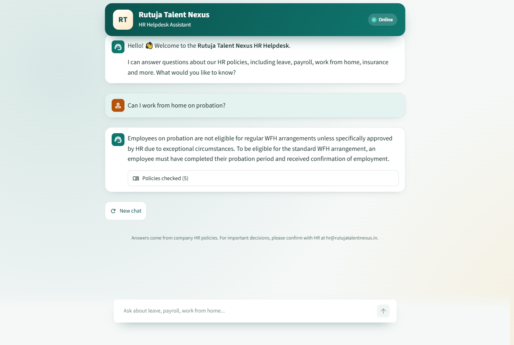
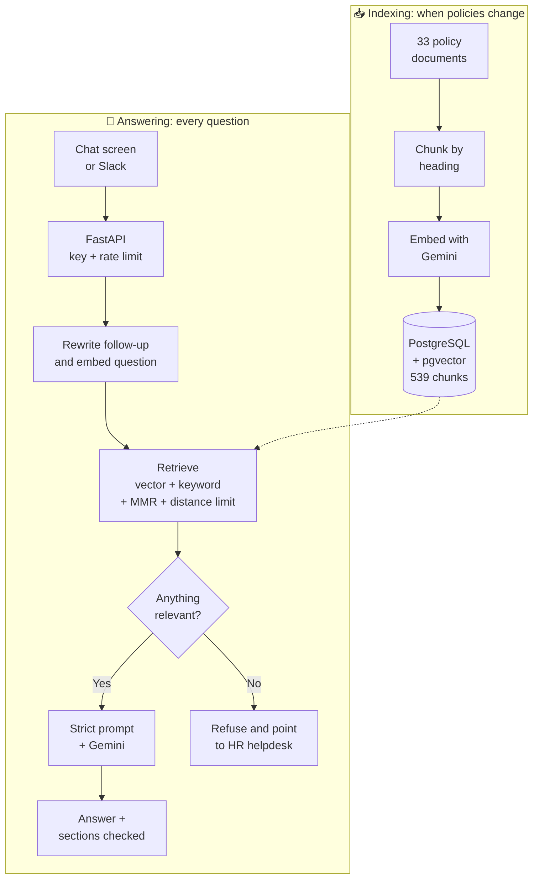

<div align="center">

# 💬 HR Policy Assistant

**An AI helpdesk that answers employee questions from company HR policies, cites where it looked, and says so when it doesn't know.**


[Features](#-features) • [How it works](#-how-it-works) • [Results](#-evaluation-results) • [Quick start](#-quick-start) • [Deploy](#-deploy-it-online) • [Project structure](#-project-structure)

<br>



</div>

---

## 🎯 The problem

Employees ask HR the same questions every day: *"What is my notice period?"*, *"Can I work from home?"*, *"How do I claim insurance?"*. The answers already exist, but they're spread across dozens of policy documents.

A general AI chatbot can't help on its own, because it has never seen the company's policies and may invent an answer. For HR, a made-up leave rule is worse than no answer.

**This project uses RAG (Retrieval-Augmented Generation):** it finds the policy sections relevant to the question, then tells the AI model to answer only from those sections.

The knowledge base is a set of 33 sample HR policy documents for a company called Rutuja Talent Nexus, covering leave, payroll, work from home, insurance, exits and more.

## ✨ Features

| | Feature | Details |
|---|---|---|
| 🧩 | **Smart chunking** | Splits documents by heading, so each chunk is one coherent section labelled with its full heading path |
| 🔍 | **Careful retrieval** | Combines vector and keyword search, uses MMR for relevant but varied results, ignores chunks too far in meaning, and removes duplicates. A local reranker is optional |
| 🛡️ | **Grounded answers** | A strict prompt limits answers to the retrieved policy text and includes conditions and exceptions |
| 🙅 | **Honest refusals** | Off-topic and unknown questions get a fixed reply pointing to the HR helpdesk |
| 📚 | **Checked citations** | Answers cite the excerpts they used, and only citations of retrieved text are kept |
| 💭 | **Stored conversations** | Chats are kept per user and tenant, with summaries, a retention period and deletion. Follow-ups like "what about on probation?" are understood from the chat, and earlier answers are never treated as policy facts |
| 🧭 | **Agent workflow** | A LangGraph workflow sorts each message and sends it to the policy search, a tool or a polite refusal, and retries a weak search once |
| 🧾 | **HR self-service** | Check leave balance and payslip, apply for leave with human approval, and raise tickets, on a mock HR system with fake employees. Every tool call is logged |
| ⚡ | **Web API** | FastAPI backend with streaming answers, API key check, rate limiting, request IDs and a health check |
| 🗂️ | **Knowledge management** | HR can upload PDF, DOCX, TXT, HTML or Markdown. Old versions are kept and can be asked about, duplicates are refused, and indexing runs as jobs that can be watched and retried. Only changed sections use embedding quota |
| 📈 | **Admin reports** | Unanswered questions and thumbs up/down show where the bot and policies fall short |
| 🔀 | **Swappable models** | Choose Gemini, Claude, OpenAI or local Ollama models with settings instead of code changes |
| 💬 | **Slack bot** | Employees can ask in Slack, using the same API as the chat screen |
| 🎨 | **Branded chat screen** | Welcome message, popular questions, typing animation and live online status, on desktop or phone |
| 📊 | **Measured quality** | A draft 123-question evaluation with chunk-level labels and a separate judge model, plus 614 automated tests |
| 🏢 | **Multiple organisations** | Row-Level Security keeps each company's documents, chats and accounts apart, with roles, sign-in and per-company API keys |
| 🔒 | **Privacy and security** | Personal data is masked before storage, logs and the model. Rate limits survive restarts, and an audit log records who did what |
| 📡 | **Running it** | JSON logs, usage metrics, optional tracing, a load test, and tested database backup and restore |
| 🔁 | **Smart indexing** | Embeds only what changed, stays within free-tier limits and carries on where it stopped if interrupted |

## 🧠 How it works

The system has two separate parts: indexing runs when policies change, and answering runs for each question.



**Why the screen and the API are separate:** the chat screen contains no AI logic and only calls the API, so another interface, such as a Slack bot, could reuse the same backend.

## 📊 Evaluation results

Measured on 200 questions in [`evaluation/data/golden_set.json`](evaluation/data/golden_set.json), with chunk-level labels, and 100 agent questions in [`evaluation/data/agent_set.json`](evaluation/data/agent_set.json).

> **These labels are still drafts.** They haven't been reviewed by the project owner yet, so treat the results as provisional. The full results, including what's still failing and which targets aren't met, are in the [Phase 8 report](evaluation/reports/phase8_report.md). The figures below are from the latest recorded run, in the [Phase 9 report](evaluation/reports/phase9_report.md).

**To review the labels,** open the review screen. It shows each question, the policy text it should find and what the bot said, and saves your decisions to the label files. It needs no API key:

```bash
venv\Scripts\streamlit run evaluation/review_app.py
```

| Check | Result | Target | What it measures |
|---|---:|---:|---|
| **Recall@5** | **0.944** | 0.90 or more | Whether search finds the labelled chunks |
| **Expected facts in answers** | **0.932** | | Keyword check against known answers. Lowest on the 9 questions where two policies disagree |
| **Correct refusals** | **0.900** | 100%: **not met** | Off-topic, unknown and "ignore your rules" questions, 40 of them. One label is probably wrong |
| **Wrongly refused** | **0.037** | | Answerable questions the bot refused |
| **Citations valid** | **1.000** | 95% or more | Citations point to chunks that were retrieved |
| **Judge: correct** | **0.968** | | Judged by a different Gemini model, using only the retrieved text |
| **p95 seconds per answer** | **12.06** | Under 6: **not met** | On this PC, counting only the attempt that worked. The median is 3.12 s. The slowest answers are the answer model's own delays |
| **Cross-tenant leaks in tests** | **0** | 0 | Isolation tests at the database, store and API levels |

**Agent test, 100 questions:** intent and routing 0.950, tool choice 0.944, and tool success, approvals and leave details all 1.000. The misses are among the 42 harder questions added in Phase 8.

**This isn't proof of production readiness.** These were measured on one PC with sample data. See [the final report](docs/FINAL_REPORT.md).

## 🚀 Quick start

**You'll need:** Python 3.13 and a free [Gemini API key](https://aistudio.google.com). Docker isn't needed, because PostgreSQL and pgvector run inside Python through `pixeltable-pgserver`.

**Commands are shown for Windows.** On Linux or macOS, use `venv/bin/` in place of `venv\Scripts\`, and `/` in place of `\` in file paths. For example:

```bash
python3 -m venv venv
```

```bash
venv/bin/pip install -r requirements.txt
```

```bash
venv/bin/uvicorn app.main:app --port 8000
```

```bash
venv/bin/streamlit run ui/streamlit_app.py
```

**Prefer containers?** If you have Docker, `docker compose up --build` starts the API, chat screen and PostgreSQL. Then run `docker compose run --rm api python -m pipeline.embed_and_store` once to index the policies. This hasn't been run yet on a machine with Docker, so CI builds the images as a check.

**1. Get the code and install it**

```bash
git clone https://github.com/Rutuja-Murkute98/hr-policy-assistant.git
cd hr-policy-assistant
python -m venv venv
venv\Scripts\pip install -r requirements.txt
```

**2. Add your keys.** Copy `.env.example` to `.env`, then fill it in:

```ini
GOOGLE_API_KEY=your_gemini_key_here
HELPDESK_API_KEY=any_long_random_text
```

**3. Index the policies.** The first run takes about 7 minutes because it stays within the free-tier rate limit. After you edit a policy, run it again: only the changed sections are embedded.

```bash
venv\Scripts\python -m pipeline.embed_and_store
```

**4. Start the API**

```bash
venv\Scripts\uvicorn app.main:app --port 8000
```

**5. Start the chat screen** in a second terminal

```bash
venv\Scripts\streamlit run ui\streamlit_app.py
```

Open **http://localhost:8501** to chat, or **http://127.0.0.1:8000/docs** to try the API directly.

### Try these questions

| Ask | Expected result |
|---|---|
| How many leaves do I get in a year? | Leave entitlements from the policy |
| Can I work from home on probation? | Not eligible, with HR's exception |
| Does the company pay for a gym membership? | Refuses, as this isn't in the policies |
| What is the capital of France? | Refuses, as this is off-topic |

## ☁️ Deploy it online

The project is ready to run for free on three services. [DEPLOY.md](DEPLOY.md) has the step-by-step guide.

| Part | Service |
|---|---|
| Chat screen | Streamlit Community Cloud |
| API | Render |
| Database | Neon (PostgreSQL + pgvector) |

## 🔌 API

| Method | Endpoint | Purpose | Who can use it |
|---|---|---|---|
| `GET` | `/live` | Checks that the server is running | Anyone |
| `GET` | `/health` | Checks the database and counts indexed chunks | Anyone |
| `POST` | `/auth/session` | Records a sign-in, and says who it is | A signed-in person |
| `GET` | `/auth/options` | Says how the sign-in page should behave | Anyone |
| `POST` | `/auth/signup` | Creates an employee account and signs in. Needs `AUTH_MODE=password`, as do the next three | Anyone |
| `POST` | `/auth/login` | Signs in with an email and password | Anyone |
| `POST` | `/auth/password` | Sets a password with a one-time code from an HR admin | Anyone with a code |
| `POST` | `/auth/logout` | Ends this session | A signed-in person |
| `GET`, `PUT` | `/me/profile` | Reads or changes your name, job title, department and work location | A signed-in person |
| `PUT`, `DELETE` | `/me/profile/photo` | Sets or removes your profile photo: PNG, JPEG or WebP, under 300 KB | A signed-in person |
| `GET`, `PATCH` | `/me/settings` | Reads or changes whether this person's chats are saved | A known user |
| `POST` | `/admin/users/{id}/setup-code` | Makes a one-time code for setting a password | HR admin |
| `GET` | `/me` | Says who's calling, and their organisation | Any caller |
| `POST` | `/ask` | Answers a question | Any caller |
| `POST` | `/ask/stream` | Sends the answer as it's written, as server-sent events: `token`, then `done` or `error` | Any caller |
| `GET`, `DELETE` | `/conversations` | Lists a user's chats, or deletes their whole history | A known user |
| `GET` | `/conversations/{id}/messages` | Reads one chat | A known user |
| `DELETE` | `/conversations/{id}` | Deletes one chat | A known user |
| `GET` | `/actions` | Lists actions waiting for approval | A known user |
| `POST` | `/actions/{id}` | Approves or declines an action, with `{"approve": true}` | A known user |
| `POST` | `/feedback` | Rates an answer | A known user |
| `GET`, `POST` | `/admin/documents` | Lists policies, or uploads one and returns an indexing job | HR admin |
| `GET` | `/admin/documents/{filename}/versions` | Lists a policy's versions | HR admin |
| `DELETE` | `/admin/documents/{filename}` | Removes a policy, keeping history unless `?purge=true` | HR admin |
| `GET` | `/admin/jobs`, `/admin/jobs/{id}` | Shows indexing jobs | HR admin |
| `POST` | `/admin/jobs/{id}/retry` | Retries a failed job | HR admin |
| `GET` | `/admin/unanswered`, `/admin/feedback` | Shows the reports | HR admin |
| `GET`, `POST` | `/admin/users` | Lists people, or lets someone sign in | HR admin |
| `PATCH` | `/admin/users/{id}` | Changes a role, or deactivates someone | HR admin |
| `GET`, `POST` | `/admin/api-keys` | Lists keys, or creates one for an integration | HR admin |
| `DELETE` | `/admin/api-keys/{id}` | Revokes a key | HR admin |
| `GET` | `/admin/audit` | Shows what's happened in this organisation | HR admin |
| `GET` | `/admin/metrics` | Reports requests, speed, tokens, cost, refusals, tool failures and feedback | HR admin |
| `GET`, `POST` | `/platform/organisations` | Lists organisations, or adds one | Platform admin |
| `PATCH` | `/platform/organisations/{id}` | Suspends or restores an organisation | Platform admin |

**How callers prove who they are** depends on `AUTH_MODE`:

- **`demo` (default):** a shared `X-API-Key`, plus `X-User-Id` to name a user, and a shared `X-Admin-Key` for admin routes. **Anyone with the key can name any user, so this is for fake data only.**
- **`password`:** people create an account or sign in on the sign-in page, and the screens send `Authorization: Bearer <session token>`. The shared keys stop working. See [DEPLOY.md](DEPLOY.md).
- **`oidc`:** people sign in and send `Authorization: Bearer <ID token>`. The shared keys stop working. Accounts must be added by an HR admin first.
- **In all of them:** a per-organisation key from `/admin/api-keys`, sent as `X-API-Key` with `X-User-Id`, lets an integration act for its own organisation's users. Treat that key like a password, because it can name any user in that organisation.

The organisation always comes from the caller's identity. No header or request field can choose it.

To ask a follow-up question, send up to 6 earlier messages as `history`, such as `[{"role": "user", "content": "How much leave do I get?"}, {"role": "assistant", "content": "..."}]`. With a known user, send `conversation_id` to use a stored chat instead.

To limit a search, send `filters` with any of `policy`, `category` and `effective_on`, such as `{"category": "leave", "effective_on": "2026-05-01"}`.

```bash
curl -X POST http://127.0.0.1:8000/ask -H "Content-Type: application/json" -H "X-API-Key: YOUR_KEY" -d "{\"question\": \"What is the notice period?\"}"
```

```json
{
  "answer": "...",
  "sources": [
    { "ref": 1, "policy": "Resignation and Exit Policy", "section": "4. Notice Period", "file": "Resignation_and_Exit_Policy.md", "chunk_id": "Resignation_and_Exit_Policy > 4. Notice Period > 0" }
  ],
  "request_id": "f89ef361787a"
}
```

## 🧪 Testing

```bash
venv\Scripts\python -m pytest tests -q
```

```bash
venv\Scripts\python -m evaluation.run_eval answers --name mine --workflow
```

The first command runs 614 tests that make no model API calls, including some on a temporary PostgreSQL. GitHub Actions is set up to run them on every push, but it hasn't run yet. The second calls Gemini many times, so it uses your quota.

## 🔧 Settings

Add these to `.env` to change how it works. `.env.example` lists them all.

| Setting | What it does |
|---|---|
| `LLM_PROVIDER`, `LLM_MODEL` | Chat model: `google` (default), `anthropic`, `openai` or `ollama`. Install the provider's package, such as `langchain-anthropic`, and set its API key |
| `EMBEDDING_PROVIDER`, `EMBEDDING_MODEL` | Embedding model: `google` (default), `openai` or `ollama`. Each model gets its own collection, so run the indexing step and measure `MAX_DISTANCE` again |
| `HYBRID_SEARCH` | Set to `false` to use vector search only |
| `CONVERSATION_RETENTION_DAYS` | How long an unused chat is kept. The default is 90 |
| `SELF_SERVICE_ENABLED` | Set to `false` to turn off the self-service tools |
| `USE_CATEGORY_ROUTING` | Set to `true` to narrow searches by topic. It's off because it lowered recall when measured |
| `LLM_TEMPERATURE`, `LLM_MAX_TOKENS`, `LLM_TIMEOUT_SECONDS`, `LLM_MAX_RETRIES` | Chat model settings, using each provider's defaults if unset |
| `LLM_FALLBACK_PROVIDER`, `LLM_FALLBACK_MODEL` | Another chat model to use if the main one fails. Off unless set, because it sends text to a second company |
| `FUSION_METHOD` | `weighted` (default) or `rrf`. RRF scored lower on the test questions |
| `ABSTENTION_MODE` | `confidence` (default) or `distance`, which uses `MAX_DISTANCE` |
| `RERANKER` | `flashrank` adds a small local reranker, with more memory use and a model download. `cohere` uses Cohere's API and needs `COHERE_API_KEY`. Both are off by default |
| `TENANT_CONFIG_FILE` | Points to the file with the company's name, HR email, branding and policy categories |
| `AUTH_MODE`, `OIDC_ISSUER`, `OIDC_CLIENT_ID` | `demo` (default), `password` for accounts with a sign-up page, or `oidc` for a sign-in provider. See [DEPLOY.md](DEPLOY.md) |
| `ALLOW_SIGNUP`, `SIGNUP_EMAIL_DOMAINS` | Whether people can create their own account, and from which email domains. On by default, for any email |
| `MIN_PASSWORD_CHARS`, `SESSION_REMEMBER_DAYS`, `SESSION_HOURS`, `SETUP_CODE_HOURS` | Password length (10), and how long a kept session (30 days), other session (12 hours) and set-up code (24 hours) last |
| `PLATFORM_ADMIN_EMAILS` | The first platform admins, who can add organisations |
| `LOG_FORMAT`, `LOG_LEVEL` | `json` (default) or `text`. See [OPERATIONS.md](docs/OPERATIONS.md) |
| `LLM_PRICE_INPUT_PER_MILLION`, `LLM_PRICE_OUTPUT_PER_MILLION` | Prices for the cost estimate. 0 by default, for a free tier |
| `LANGFUSE_PUBLIC_KEY`, `LANGFUSE_SECRET_KEY` | Sends model calls to Langfuse. Off unless both are set, because it shares prompts |
| `REDIS_URL` | Counts rate limits in Redis instead of PostgreSQL. Needs `requirements-redis.txt` |
| `AUDIT_RETENTION_DAYS` | How long audit entries are kept: 365 by default |
| `HELPDESK_ADMIN_KEY` | Turns on the admin endpoints and the screen at `/admin` on the chat screen's address |

## 📁 Project structure

```text
hr-policy-assistant/
├── app/                       # The API
│   ├── main.py                # /ask, /ask/stream, /health and chats
│   ├── admin.py               # HR admin: policies, jobs and reports
│   ├── accounts.py            # Sign-in, people, API keys, audit and organisations
│   ├── workflow.py            # Runs the graph, and saves chats and approvals
│   ├── memory.py              # Stored conversations
│   ├── knowledge.py           # Versions, indexing jobs and reports
│   ├── identity.py            # Organisations, users, API keys, tokens and audit log
│   ├── security.py            # Who's calling, and lasting rate limits
│   ├── tenancy.py             # Row-Level Security: keeps each organisation's data apart
│   ├── pii.py                 # Masks personal data in text and logs
│   ├── guards.py              # Prompt injection defences
│   ├── observability.py       # JSON logs, usage counting and optional tracing
│   ├── metrics.py             # Per-answer metrics and reports
│   ├── config.py              # Settings, checked at startup
│   ├── db.py                  # Database connection
│   ├── agent/                 # LangGraph workflow, tools and mock HR system
│   └── rag/                   # Search, reranking, prompts, models and answers
├── pipeline/                  # Reading, chunking and indexing policies
├── ui/                        # Chat screen, and the admin screen at /admin
├── integrations/              # Slack bot
├── migrations/                # Database changes, run by Alembic at startup
├── policies/                  # 33 sample HR policy documents
├── config/                    # Company details, and the mock HR system's fake employees
├── evaluation/
│   ├── data/                  # 123 golden and 58 agent questions, with draft labels
│   ├── reports/               # Latest results and the Phase 5 report
│   │   └── history/           # Reports from earlier phases
│   ├── run_eval.py            # Compares search settings and measures answers
│   ├── run_agent_eval.py      # Measures intent, routing, tools and approvals
│   ├── metrics.py             # Recall, precision, MRR, NDCG and fact checks
│   ├── agent_metrics.py       # Scores for the agent test
│   ├── golden.py              # Loads the golden set
│   └── quality_gate.py        # Fails CI if results are stale or too low
├── loadtest/                  # Locust load test
├── ops/                       # Database backup and restore
├── tests/                     # unit/ and integration/
├── docs/                      # Final report, architecture, decisions, status, operations and DPDP notes
├── .github/workflows/ci.yml   # Tests, code checks and image builds on every push
├── .streamlit/                # Chat screen theme
├── DEPLOY.md                  # Step-by-step deploy and upgrade guide
├── render.yaml                # API settings for Render
├── docker-compose.yml         # API, chat screen and PostgreSQL for local use
├── Dockerfile.api, Dockerfile.ui
├── requirements-api.txt       # What the hosted API needs
├── requirements.txt           # Everything for your own PC
├── requirements-dev.txt       # Tests and code checks
├── requirements-redis.txt     # Optional: rate limits in Redis
├── requirements-tracing.txt   # Optional: tracing with Langfuse
├── alembic.ini, pyproject.toml, .python-version
└── .env.example               # Every setting, with notes
```

## 🛠️ Tech stack

| Layer | Technology |
|---|---|
| Language | Python 3.13 |
| RAG framework | LangChain |
| Workflow | LangGraph, with paused runs saved in PostgreSQL |
| Chat model | Gemini (`gemini-3.5-flash-lite`) by default, or Claude, OpenAI or Ollama |
| Embeddings | Gemini (`gemini-embedding-2`) by default, or OpenAI or Ollama |
| Vector database | PostgreSQL + pgvector: embedded with `pixeltable-pgserver` on your PC, Neon when hosted |
| Backend | FastAPI + Uvicorn |
| Frontend | Streamlit with custom CSS, plus a Slack bot (Bolt for Python) |
| Evaluation | Chunk-level metrics, plus a separate judge model |
| Testing | pytest, ruff, mypy, pip-audit and GitHub Actions |
| Configuration | Pydantic Settings and a tenant file |
| Migrations | Alembic |

## 👩‍💻 Author

**Rutuja Sudam Murkute** · [@Rutuja-Murkute98](https://github.com/Rutuja-Murkute98)

<div align="center">

<br>

⭐ *If you find this project useful, please give it a star!*

</div>
