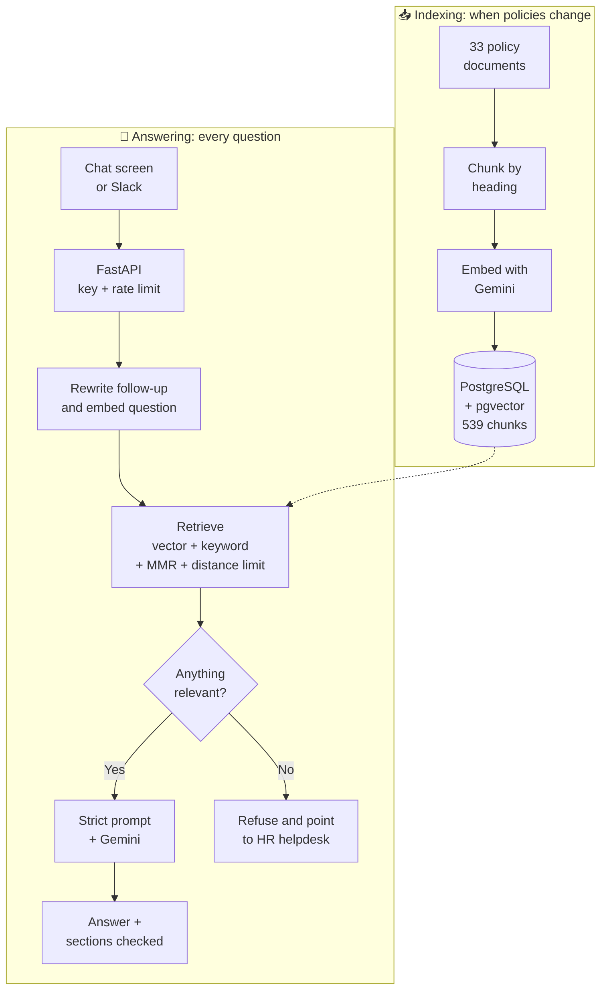

<div align="center">

# 💬 HR Policy Assistant

**An AI helpdesk that answers employee questions from company HR policies, cites where it looked, and says so when it doesn't know.**


[Features](#-features) • [How it works](#-how-it-works) • [Results](#-evaluation-results) • [Quick start](#-quick-start) • [Deploy](#-deploy-it-online) • [Project structure](#-project-structure)

<br>


</div>

---

## 🎯 The problem

Employees ask HR the same questions every day: *"What is my notice period?"*, *"Can I work from home?"*, *"How do I claim insurance?"*. The answers already exist, but they're spread across dozens of policy documents.

A general AI chatbot can't help on its own, because it has never seen the company's policies and may invent an answer. For HR, a made-up leave rule is worse than no answer.

**This project uses RAG (Retrieval-Augmented Generation):** it finds the policy sections relevant to the question, then tells the AI model to answer only from those sections.

The knowledge base is a set of 33 sample HR policy documents for a company called Rutuja Talent Nexus, covering leave, payroll, work from home, insurance, exits and more.

## ✨ Features

| | Feature | Details |
|---|---|---|
| 🧩 | **Smart chunking** | Splits documents by heading, so each chunk is one coherent section labelled with its full heading path |
| 🔍 | **Careful retrieval** | Combines vector and keyword search, uses MMR for relevant but varied results, ignores chunks too far in meaning, and removes duplicates. A local reranker is optional |
| 🛡️ | **Grounded answers** | A strict prompt limits answers to the retrieved policy text and includes conditions and exceptions |
| 🙅 | **Honest refusals** | Off-topic and unknown questions get a fixed reply pointing to the HR helpdesk |
| 📚 | **Checked citations** | Answers cite the excerpts they used, and only citations of retrieved text are kept |
| 💭 | **Stored conversations** | Chats are kept per user and tenant, with summaries, a retention period and deletion. Follow-ups like "what about on probation?" are understood from the chat, and earlier answers are never treated as policy facts |
| 🧭 | **Agent workflow** | A LangGraph workflow sorts each message and sends it to the policy search, a tool or a polite refusal, and retries a weak search once |
| 🧾 | **HR self-service** | Check leave balance and payslip, apply for leave with human approval, and raise tickets, on a mock HR system with fake employees. Every tool call is logged |
| ⚡ | **Web API** | FastAPI backend with streaming answers, API key check, rate limiting, request IDs and a health check |
| 🗂️ | **Knowledge management** | HR can upload PDF, DOCX, TXT, HTML or Markdown. Old versions are kept and can be asked about, duplicates are refused, and indexing runs as jobs that can be watched and retried. Only changed sections use embedding quota |
| 📈 | **Admin reports** | Unanswered questions and thumbs up/down show where the bot and policies fall short |
| 🔀 | **Swappable models** | Choose Gemini, Claude, OpenAI or local Ollama models with settings instead of code changes |
| 💬 | **Slack bot** | Employees can ask in Slack, using the same API as the chat screen |
| 🎨 | **Branded chat screen** | Welcome message, popular questions, typing animation and live online status, on desktop or phone |
| 📊 | **Measured quality** | A draft 123-question evaluation with chunk-level labels and a separate judge model, plus 397 automated tests |
| 🔁 | **Smart indexing** | Embeds only what changed, stays within free-tier limits and carries on where it stopped if interrupted |

## 🧠 How it works

The system has two separate parts: indexing runs when policies change, and answering runs for each question.



**Why the screen and the API are separate:** the chat screen contains no AI logic and only calls the API, so another interface, such as a Slack bot, could reuse the same backend.

## 📊 Evaluation results

Measured on 123 questions in [`evaluation/data/golden_set.json`](evaluation/data/golden_set.json), with chunk-level labels, and 58 agent questions in [`evaluation/data/agent_set.json`](evaluation/data/agent_set.json).

> **These labels are still drafts.** They haven't been reviewed by the project owner yet, so treat the results as provisional. The full results, including what's still failing and which targets aren't met, are in the [Phase 3 report](evaluation/reports/phase3_report.md).

| Check | Result | What it measures |
|---|---:|---|
| **Recall@5** | **0.943** | Whether search finds the labelled chunks |
| **Expected facts in answers** | **0.943** | Keyword check against known answers |
| **Correct refusals** | **0.962** | Off-topic, unknown and "ignore your rules" questions. One of these is a likely wrong label |
| **Wrongly refused** | **0.031** | Answerable questions the bot refused |
| **Citations valid** | **1.000** | Citations point to chunks that were retrieved |
| **Judge: correct** | **0.979** | Judged by a different Gemini model, using only the retrieved text |
| **p95 seconds per answer** | **8.08** | Still above the 6 second target |

**Agent test:** intent, routing, tool selection, tool success and approval compliance all scored 1.000 on 58 clear-cut questions.

## 🚀 Quick start

**You'll need:** Python 3.13 and a free [Gemini API key](https://aistudio.google.com). Docker isn't needed, because PostgreSQL and pgvector run inside Python through `pixeltable-pgserver`.

**Commands are shown for Windows.** On Linux or macOS, use `venv/bin/` in place of `venv\Scripts\`, and `/` in place of `\` in file paths. For example:

```bash
python3 -m venv venv
```

```bash
venv/bin/pip install -r requirements.txt
```

```bash
venv/bin/uvicorn app.main:app --port 8000
```

```bash
venv/bin/streamlit run ui/streamlit_app.py
```

**Prefer containers?** If you have Docker, `docker compose up --build` starts the API, chat screen and PostgreSQL. Then run `docker compose run --rm api python -m pipeline.embed_and_store` once to index the policies. This hasn't been run yet on a machine with Docker, so CI builds the images as a check.

**1. Get the code and install it**

```bash
git clone https://github.com/Rutuja-Murkute98/hr-policy-assistant.git
cd hr-policy-assistant
python -m venv venv
venv\Scripts\pip install -r requirements.txt
```

**2. Add your keys.** Copy `.env.example` to `.env`, then fill it in:

```ini
GOOGLE_API_KEY=your_gemini_key_here
HELPDESK_API_KEY=any_long_random_text
```

**3. Index the policies.** The first run takes about 7 minutes because it stays within the free-tier rate limit. After you edit a policy, run it again: only the changed sections are embedded.

```bash
venv\Scripts\python -m pipeline.embed_and_store
```

**4. Start the API**

```bash
venv\Scripts\uvicorn app.main:app --port 8000
```

**5. Start the chat screen** in a second terminal

```bash
venv\Scripts\streamlit run ui\streamlit_app.py
```

Open **http://localhost:8501** to chat, or **http://127.0.0.1:8000/docs** to try the API directly.

### Try these questions

| Ask | Expected result |
|---|---|
| How many leaves do I get in a year? | Leave entitlements from the policy |
| Can I work from home on probation? | Not eligible, with HR's exception |
| Does the company pay for a gym membership? | Refuses, as this isn't in the policies |
| What is the capital of France? | Refuses, as this is off-topic |

## ☁️ Deploy it online

The project is ready to run for free on three services. [DEPLOY.md](DEPLOY.md) has the step-by-step guide.

| Part | Service |
|---|---|
| Chat screen | Streamlit Community Cloud |
| API | Render |
| Database | Neon (PostgreSQL + pgvector) |

## 🔌 API

| Method | Endpoint | Purpose | API key |
|---|---|---|---|
| `GET` | `/live` | Checks that the server is running | Not needed |
| `GET` | `/health` | Checks the database and counts indexed chunks | Not needed |
| `POST` | `/ask` | Answers a question | `X-API-Key` header |
| `GET`, `DELETE` | `/conversations` | Lists a user's chats, or deletes their whole history | `X-API-Key` and `X-User-Id` headers |
| `GET` | `/conversations/{id}/messages` | Reads one chat | `X-API-Key` and `X-User-Id` headers |
| `DELETE` | `/conversations/{id}` | Deletes one chat | `X-API-Key` and `X-User-Id` headers |
| `GET` | `/actions` | Lists actions waiting for approval | `X-API-Key` and `X-User-Id` headers |
| `POST` | `/actions/{id}` | Approves or declines an action, with `{"approve": true}` | `X-API-Key` and `X-User-Id` headers |
| `POST` | `/ask/stream` | Sends the answer as it's written, as server-sent events: `token`, then `done` or `error` | `X-API-Key` header |
| `POST` | `/feedback` | Rates an answer | `X-API-Key` and `X-User-Id` headers |
| `GET` | `/admin/documents` | Lists the policies in the knowledge base | `X-Admin-Key` header |
| `POST` | `/admin/documents` | Uploads a policy file, and returns an indexing job | `X-Admin-Key` header |
| `GET` | `/admin/documents/{filename}/versions` | Lists a policy's versions | `X-Admin-Key` header |
| `DELETE` | `/admin/documents/{filename}` | Removes a policy, keeping history unless `?purge=true` | `X-Admin-Key` header |
| `GET` | `/admin/jobs`, `/admin/jobs/{id}` | Shows indexing jobs | `X-Admin-Key` header |
| `POST` | `/admin/jobs/{id}/retry` | Retries a failed job | `X-Admin-Key` header |
| `GET` | `/admin/unanswered`, `/admin/feedback` | Shows the reports | `X-Admin-Key` header |

To ask a follow-up question, send up to 6 earlier messages as `history`, such as `[{"role": "user", "content": "How much leave do I get?"}, {"role": "assistant", "content": "18 days."}]`. The server keeps no chat history itself.

Send an `X-User-Id` header and `conversation_id` to use a stored chat. **This is a demo identity:** real sign-in comes in Phase 4, and until then anyone with the API key can name any user, so keep it on fake data.

To limit a search, send `filters` with any of `policy`, `category` and `effective_on`, such as `{"category": "leave", "effective_on": "2026-05-01"}`.

```bash
curl -X POST http://127.0.0.1:8000/ask -H "Content-Type: application/json" -H "X-API-Key: YOUR_KEY" -d "{\"question\": \"What is the notice period?\"}"
```

```json
{
  "answer": "...",
  "sources": [
    { "ref": 1, "policy": "Resignation and Exit Policy", "section": "4. Notice Period", "file": "Resignation_and_Exit_Policy.md", "chunk_id": "Resignation_and_Exit_Policy > 4. Notice Period > 0" }
  ],
  "request_id": "f89ef361787a"
}
```

## 🧪 Testing

```bash
venv\Scripts\python -m pytest tests -q
```

```bash
venv\Scripts\python -m evaluation.rag_evaluation --ragas
```

The first command runs 397 tests that make no model API calls, including some on a temporary PostgreSQL. GitHub Actions is set up to run them on every push, but it hasn't run yet. The second calls Gemini many times, so it uses your quota.

## 🔧 Settings

Add these to `.env` to change how it works. `.env.example` lists them all.

| Setting | What it does |
|---|---|
| `LLM_PROVIDER`, `LLM_MODEL` | Chat model: `google` (default), `anthropic`, `openai` or `ollama`. Install the provider's package, such as `langchain-anthropic`, and set its API key |
| `EMBEDDING_PROVIDER`, `EMBEDDING_MODEL` | Embedding model: `google` (default), `openai` or `ollama`. Each model gets its own collection, so run the indexing step and measure `MAX_DISTANCE` again |
| `HYBRID_SEARCH` | Set to `false` to use vector search only |
| `CONVERSATION_RETENTION_DAYS` | How long an unused chat is kept. The default is 90 |
| `SELF_SERVICE_ENABLED` | Set to `false` to turn off the self-service tools |
| `USE_CATEGORY_ROUTING` | Set to `true` to narrow searches by topic. It's off because it lowered recall when measured |
| `LLM_TEMPERATURE`, `LLM_MAX_TOKENS`, `LLM_TIMEOUT_SECONDS`, `LLM_MAX_RETRIES` | Chat model settings, using each provider's defaults if unset |
| `LLM_FALLBACK_PROVIDER`, `LLM_FALLBACK_MODEL` | Another chat model to use if the main one fails. Off unless set, because it sends text to a second company |
| `FUSION_METHOD` | `weighted` (default) or `rrf`. RRF scored lower on the test questions |
| `ABSTENTION_MODE` | `confidence` (default) or `distance`, which uses `MAX_DISTANCE` |
| `RERANKER` | `flashrank` adds a small local reranker, with more memory use and a model download. `cohere` uses Cohere's API and needs `COHERE_API_KEY`. Both are off by default |
| `TENANT_CONFIG_FILE` | Points to the file with the company's name, HR email, branding and policy categories |
| `HELPDESK_ADMIN_KEY` | Turns on the admin endpoints and the screen at `/admin` on the chat screen's address |

## 📁 Project structure

```text
hr-policy-assistant/
├── app/
│   ├── main.py               # FastAPI: /ask, /ask/stream, /health, request logging
│   ├── admin.py              # Admin endpoints for managing policies
│   ├── knowledge.py          # Versions, indexing jobs and reports
│   ├── workflow.py           # Runs the graph, and saves chats and approvals
│   ├── memory.py             # Stored conversations
│   ├── agent/                # LangGraph workflow, tools and mock HR system
│   ├── security.py           # API key check and rate limiter
│   ├── config.py             # Settings, checked at startup
│   └── rag/
│       ├── service.py        # Answers, streaming and follow-up questions
│       ├── retrieval.py      # Scoring, filtering and MMR
│       ├── rerank.py         # Optional local reranker
│       ├── providers.py      # Choosing the chat and embedding models
│       ├── prompt.py         # Strict prompt and refusal message
│       └── store.py          # Vector database connection
├── pipeline/
│   ├── extract.py            # Reads PDF, DOCX, TXT, HTML and Markdown
│   ├── chunk_documents.py    # Heading-based chunking
│   ├── embed_and_store.py    # Embeds only what changed, and can resume
│   └── copy_to_cloud.py      # Copy chunks to a hosted database
├── ui/
│   ├── streamlit_app.py      # Chat screen
│   ├── pages/admin.py        # Policy admin screen
│   └── style.css             # Branding and animations
├── evaluation/
│   ├── test_set.py           # 25 hand-checked questions
│   ├── rag_evaluation.py     # Simple checks and RAGAS
│   ├── run_eval.py           # Compares search settings and measures answers
│   ├── metrics.py            # Recall, precision, MRR, NDCG and fact checks
│   ├── quality_gate.py       # Fails CI if results are stale or too low
│   ├── run_agent_eval.py     # Measures intent, routing, tools and approvals
│   ├── data/golden_set.json  # 123 draft questions with chunk labels
│   ├── reports/              # Baseline vs new results
│   └── results/              # Saved answers and scores
├── integrations/slack_bot.py # Slack bot
├── tests/unit/               # Automated tests
├── .github/workflows/ci.yml  # Runs the tests on every push
├── policies/policies/        # 33 HR policy documents
├── config/tenant.toml        # Company details and policy categories
├── migrations/               # Database changes, run by Alembic at startup
├── docs/                     # Architecture, decisions and status
├── docker-compose.yml        # API, chat screen and PostgreSQL for local use
├── render.yaml               # API settings for Render
├── DEPLOY.md                 # Step-by-step deploy guide
├── mini_rag.py               # The first one-file version
└── INTERN_RAG_BUILD_GUIDE.md # The guide this project follows
```

## 🛠️ Tech stack

| Layer | Technology |
|---|---|
| Language | Python 3.13 |
| RAG framework | LangChain |
| Workflow | LangGraph, with paused runs saved in PostgreSQL |
| Chat model | Gemini (`gemini-3.5-flash-lite`) by default, or Claude, OpenAI or Ollama |
| Embeddings | Gemini (`gemini-embedding-2`) by default, or OpenAI or Ollama |
| Vector database | PostgreSQL + pgvector: embedded with `pixeltable-pgserver` on your PC, Neon when hosted |
| Backend | FastAPI + Uvicorn |
| Frontend | Streamlit with custom CSS, plus a Slack bot (Bolt for Python) |
| Evaluation | RAGAS + custom checks |
| Testing | pytest, ruff, mypy, pip-audit and GitHub Actions |
| Configuration | Pydantic Settings and a tenant file |
| Migrations | Alembic |

## 👩‍💻 Author

**Rutuja Sudam Murkute** · [@Rutuja-Murkute98](https://github.com/Rutuja-Murkute98)

<div align="center">

<br>

⭐ *If you find this project useful, please give it a star!*

</div>
