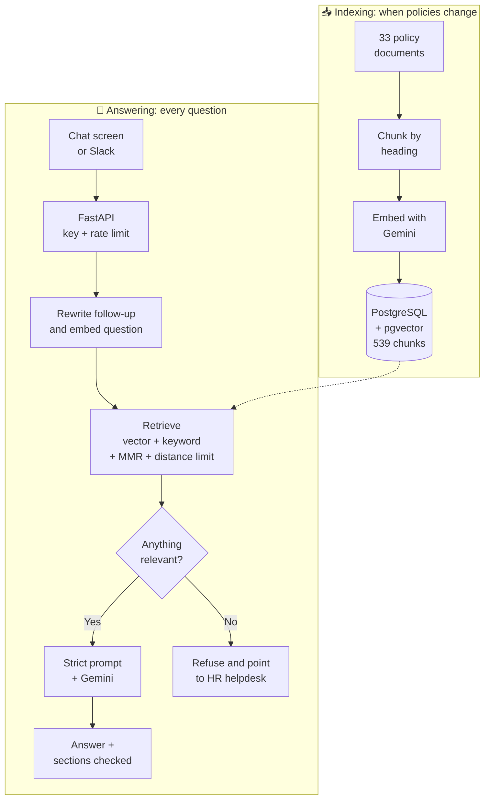

<div align="center">

# 💬 HR Policy Assistant

**An AI helpdesk that answers employee questions from company HR policies, cites where it looked, and says so when it doesn't know.**


[Features](#-features) • [How it works](#-how-it-works) • [Results](#-evaluation-results) • [Quick start](#-quick-start) • [Deploy](#-deploy-it-online) • [Project structure](#-project-structure)

<br>


</div>

---

## 🎯 The problem

Employees ask HR the same questions every day: *"What is my notice period?"*, *"Can I work from home?"*, *"How do I claim insurance?"*. The answers already exist, but they're spread across dozens of policy documents.

A general AI chatbot can't help on its own, because it has never seen the company's policies and may invent an answer. For HR, a made-up leave rule is worse than no answer.

**This project uses RAG (Retrieval-Augmented Generation):** it finds the policy sections relevant to the question, then tells the AI model to answer only from those sections.

The knowledge base is a set of 33 sample HR policy documents for a company called Rutuja Talent Nexus, covering leave, payroll, work from home, insurance, exits and more.

## ✨ Features

| | Feature | Details |
|---|---|---|
| 🧩 | **Smart chunking** | Splits documents by heading, so each chunk is one coherent section labelled with its full heading path |
| 🔍 | **Careful retrieval** | Combines vector and keyword search, uses MMR for relevant but varied results, ignores chunks too far in meaning, and removes duplicates. A local reranker is optional |
| 🛡️ | **Grounded answers** | A strict prompt limits answers to the retrieved policy text and includes conditions and exceptions |
| 🙅 | **Honest refusals** | Off-topic and unknown questions get a fixed reply pointing to the HR helpdesk |
| 📚 | **Policy references** | Each answer lists the policy sections that were checked |
| 💭 | **Follow-up questions** | Understands questions like "what about on probation?" from the chat so far, without treating earlier answers as policy facts |
| ⚡ | **Web API** | FastAPI backend with streaming answers, API key check, rate limiting, request IDs and a health check |
| 🗂️ | **Policy admin screen** | HR can add, replace or remove a policy, and only the sections that changed use embedding quota |
| 🔀 | **Swappable models** | Choose Gemini, Claude, OpenAI or local Ollama models with settings instead of code changes |
| 💬 | **Slack bot** | Employees can ask in Slack, using the same API as the chat screen |
| 🎨 | **Branded chat screen** | Welcome message, popular questions, typing animation and live online status, on desktop or phone |
| 📊 | **Measured quality** | A 25-question evaluation with RAGAS scores, a retrieval benchmark, and 116 automated tests that run on every push |
| 🔁 | **Smart indexing** | Embeds only what changed, stays within free-tier limits and carries on where it stopped if interrupted |

## 🧠 How it works

The system has two separate parts: indexing runs when policies change, and answering runs for each question.



**Why the screen and the API are separate:** the chat screen contains no AI logic and only calls the API, so another interface, such as a Slack bot, could reuse the same backend.

## 📊 Evaluation results

Measured on the 25 hand-checked questions in [`evaluation/test_set.py`](evaluation/test_set.py): 20 with known answers and 5 the bot must refuse.

| Check | Score | What it measures |
|---|---:|---|
| **Faithfulness** (RAGAS) | **1.000** | Whether answers stick to the retrieved text |
| **Context recall** (RAGAS) | **1.000** | Whether retrieval found what the answer needs |
| **Context precision** (RAGAS) | **0.890** | Whether the most useful chunks ranked highest |
| **Expected facts in answers** | **20 / 20** | Keyword check against known correct answers |
| **Correct refusals** | **5 / 5** | Off-topic, unknown and "ignore your rules" questions |
| **Right policy retrieved** | **20 / 20** | Whether search found the correct document |

> **How to read these scores:** this is a small test set of mostly single-fact questions, and the RAGAS scores were judged by the same Gemini model that writes the answers. They show the system works on these cases, not that it's perfect.

### Comparing search settings

[`evaluation/retrieval_benchmark.py`](evaluation/retrieval_benchmark.py) checks whether search finds the right policy section, on the 19 answerable questions with one clear section and 10 short questions built around an exact term such as "UAN" or "FIR". Reciprocal rank shows how high up the section was: 1 means first and 0.5 means second.

| Setting | Policy questions found | Reciprocal rank | Exact terms found | Reciprocal rank |
|---|---:|---:|---:|---:|
| Vector only | 19 / 19 | 0.899 | 9 / 10 | 0.617 |
| **Vector + keyword (default)** | **19 / 19** | **0.896** | **9 / 10** | **0.675** |
| Vector + keyword + reranker | 19 / 19 | 0.930 | 10 / 10 | 0.770 |

> **How to read this:** the weights were chosen using these same questions, so the gains may be smaller on new ones. Context precision was 0.930 before keyword search was added, and that drop hasn't been traced to a single cause.

## 🚀 Quick start

**You'll need:** Python 3.13 and a free [Gemini API key](https://aistudio.google.com). Docker isn't needed, because PostgreSQL and pgvector run inside Python through `pixeltable-pgserver`.

**1. Get the code and install it** (Windows commands shown)

```bash
git clone https://github.com/Rutuja-Murkute98/hr-policy-assistant.git
cd hr-policy-assistant
python -m venv venv
venv\Scripts\pip install -r requirements.txt
```

**2. Add your keys.** Copy `.env.example` to `.env`, then fill it in:

```ini
GOOGLE_API_KEY=your_gemini_key_here
HELPDESK_API_KEY=any_long_random_text
```

**3. Index the policies.** The first run takes about 7 minutes because it stays within the free-tier rate limit. After you edit a policy, run it again: only the changed sections are embedded.

```bash
venv\Scripts\python -m pipeline.embed_and_store
```

**4. Start the API**

```bash
venv\Scripts\uvicorn app.main:app --port 8000
```

**5. Start the chat screen** in a second terminal

```bash
venv\Scripts\streamlit run ui\streamlit_app.py
```

Open **http://localhost:8501** to chat, or **http://127.0.0.1:8000/docs** to try the API directly.

### Try these questions

| Ask | Expected result |
|---|---|
| How many leaves do I get in a year? | Leave entitlements from the policy |
| Can I work from home on probation? | Not eligible, with HR's exception |
| Does the company pay for a gym membership? | Refuses, as this isn't in the policies |
| What is the capital of France? | Refuses, as this is off-topic |

## ☁️ Deploy it online

The project is ready to run for free on three services. [DEPLOY.md](DEPLOY.md) has the step-by-step guide.

| Part | Service |
|---|---|
| Chat screen | Streamlit Community Cloud |
| API | Render |
| Database | Neon (PostgreSQL + pgvector) |

## 🔌 API

| Method | Endpoint | Purpose | API key |
|---|---|---|---|
| `GET` | `/live` | Checks that the server is running | Not needed |
| `GET` | `/health` | Checks the database and counts indexed chunks | Not needed |
| `POST` | `/ask` | Answers a question | `X-API-Key` header |
| `POST` | `/ask/stream` | Sends the answer as it's written, as server-sent events: `token`, then `done` or `error` | `X-API-Key` header |
| `GET` | `/admin/documents` | Lists the policies in the knowledge base | `X-Admin-Key` header |
| `POST` | `/admin/documents` | Adds or replaces a policy | `X-Admin-Key` header |
| `DELETE` | `/admin/documents/{filename}` | Removes a policy | `X-Admin-Key` header |

To ask a follow-up question, send up to 6 earlier messages as `history`, such as `[{"role": "user", "content": "How much leave do I get?"}, {"role": "assistant", "content": "18 days."}]`. The server keeps no chat history itself.

```bash
curl -X POST http://127.0.0.1:8000/ask -H "Content-Type: application/json" -H "X-API-Key: YOUR_KEY" -d "{\"question\": \"What is the notice period?\"}"
```

```json
{
  "answer": "...",
  "sources": [
    { "policy": "Resignation and Exit Policy", "section": "4. Notice Period", "file": "Resignation_and_Exit_Policy.md" }
  ],
  "request_id": "f89ef361787a"
}
```

## 🧪 Testing

```bash
venv\Scripts\python -m pytest tests -q
```

```bash
venv\Scripts\python -m evaluation.rag_evaluation --ragas
```

The first command runs 116 offline tests that make no API calls, and GitHub Actions runs them on every push. The second calls Gemini many times, so it uses your quota.

## 🔧 Settings

Add these to `.env` to change how it works. `.env.example` lists them all.

| Setting | What it does |
|---|---|
| `LLM_PROVIDER`, `LLM_MODEL` | Chat model: `google` (default), `anthropic`, `openai` or `ollama`. Install the provider's package, such as `langchain-anthropic`, and set its API key |
| `EMBEDDING_PROVIDER`, `EMBEDDING_MODEL` | Embedding model: `google` (default), `openai` or `ollama`. Each model gets its own collection, so run the indexing step and measure `MAX_DISTANCE` again |
| `HYBRID_SEARCH` | Set to `false` to use vector search only |
| `RERANKER` | Set to `flashrank` to add a small local reranker. It's off by default because it adds memory use and a model download |
| `HELPDESK_ADMIN_KEY` | Turns on the admin endpoints and the screen at `/admin` on the chat screen's address |

## 📁 Project structure

```text
hr-policy-assistant/
├── app/
│   ├── main.py               # FastAPI: /ask, /ask/stream, /health, request logging
│   ├── admin.py              # Admin endpoints for managing policies
│   ├── security.py           # API key check and rate limiter
│   ├── config.py             # All settings in one place
│   └── rag/
│       ├── service.py        # Answers, streaming and follow-up questions
│       ├── retrieval.py      # Scoring, filtering and MMR
│       ├── rerank.py         # Optional local reranker
│       ├── providers.py      # Choosing the chat and embedding models
│       ├── prompt.py         # Strict prompt and refusal message
│       └── store.py          # Vector database connection
├── pipeline/
│   ├── chunk_documents.py    # Heading-based chunking
│   ├── embed_and_store.py    # Embeds only what changed, and can resume
│   └── copy_to_cloud.py      # Copy chunks to a hosted database
├── ui/
│   ├── streamlit_app.py      # Chat screen
│   ├── pages/admin.py        # Policy admin screen
│   └── style.css             # Branding and animations
├── evaluation/
│   ├── test_set.py           # 25 hand-checked questions
│   ├── rag_evaluation.py     # Simple checks and RAGAS
│   ├── retrieval_benchmark.py # Compares search settings
│   └── results/              # Saved answers and scores
├── integrations/slack_bot.py # Slack bot
├── tests/unit/               # Automated tests
├── .github/workflows/ci.yml  # Runs the tests on every push
├── policies/policies/        # 33 HR policy documents
├── render.yaml               # API settings for Render
├── DEPLOY.md                 # Step-by-step deploy guide
├── mini_rag.py               # The first one-file version
└── INTERN_RAG_BUILD_GUIDE.md # The guide this project follows
```

## 🛠️ Tech stack

| Layer | Technology |
|---|---|
| Language | Python 3.13 |
| RAG framework | LangChain |
| Chat model | Gemini (`gemini-3.5-flash-lite`) by default, or Claude, OpenAI or Ollama |
| Embeddings | Gemini (`gemini-embedding-2`) by default, or OpenAI or Ollama |
| Vector database | PostgreSQL + pgvector: embedded with `pixeltable-pgserver` on your PC, Neon when hosted |
| Backend | FastAPI + Uvicorn |
| Frontend | Streamlit with custom CSS, plus a Slack bot (Bolt for Python) |
| Evaluation | RAGAS + custom checks |
| Testing | pytest and GitHub Actions |

## 👩‍💻 Author

**Rutuja Sudam Murkute** · [@Rutuja-Murkute98](https://github.com/Rutuja-Murkute98)

<div align="center">

<br>

⭐ *If you find this project useful, please give it a star!*

</div>
