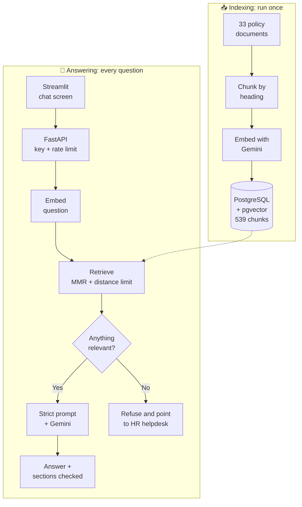

<div align="center">

# 💬 HR Policy Assistant

**An AI helpdesk that answers employee questions from company HR policies, cites where it looked, and says so when it doesn't know.**


[Features](#-features) • [How it works](#-how-it-works) • [Results](#-evaluation-results) • [Quick start](#-quick-start) • [Deploy](#-deploy-it-online) • [Project structure](#-project-structure)

<br>


</div>

---

## 🎯 The problem

Employees ask HR the same questions every day: *"What is my notice period?"*, *"Can I work from home?"*, *"How do I claim insurance?"*. The answers already exist, but they're spread across dozens of policy documents.

A general AI chatbot can't help on its own, because it has never seen the company's policies and may invent an answer. For HR, a made-up leave rule is worse than no answer.

**This project uses RAG (Retrieval-Augmented Generation):** it finds the policy sections relevant to the question, then tells the AI model to answer only from those sections.

The knowledge base is a set of 33 sample HR policy documents for a company called Rutuja Talent Nexus, covering leave, payroll, work from home, insurance, exits and more.

## ✨ Features

| | Feature | Details |
|---|---|---|
| 🧩 | **Smart chunking** | Splits documents by heading, so each chunk is one coherent section labelled with its full heading path |
| 🔍 | **Careful retrieval** | Uses MMR for relevant but varied results, ignores chunks too far in meaning, and removes duplicates |
| 🛡️ | **Grounded answers** | A strict prompt limits answers to the retrieved policy text and includes conditions and exceptions |
| 🙅 | **Honest refusals** | Off-topic and unknown questions get a fixed reply pointing to the HR helpdesk |
| 📚 | **Policy references** | Each answer lists the policy sections that were checked |
| ⚡ | **Web API** | FastAPI backend with API key check, rate limiting, request IDs and a health check |
| 🎨 | **Branded chat screen** | Welcome message, popular questions, typing animation and live online status, on desktop or phone |
| 📊 | **Measured quality** | A 25-question evaluation with RAGAS scores, plus 43 automated tests |
| 🔁 | **Resumable indexing** | Stays within free-tier limits and carries on where it stopped if interrupted |

## 🧠 How it works

The system has two separate parts: indexing runs once, offline, and answering runs for each question.



**Why the screen and the API are separate:** the chat screen contains no AI logic and only calls the API, so another interface, such as a Slack bot, could reuse the same backend.

## 📊 Evaluation results

Measured on the 25 hand-checked questions in [`evaluation/test_set.py`](evaluation/test_set.py): 20 with known answers and 5 the bot must refuse.

| Check | Score | What it measures |
|---|---:|---|
| **Faithfulness** (RAGAS) | **0.995** | Whether answers stick to the retrieved text |
| **Context recall** (RAGAS) | **1.000** | Whether retrieval found what the answer needs |
| **Context precision** (RAGAS) | **0.930** | Whether the most useful chunks ranked highest |
| **Expected facts in answers** | **20 / 20** | Keyword check against known correct answers |
| **Correct refusals** | **5 / 5** | Off-topic, unknown and "ignore your rules" questions |
| **Right policy retrieved** | **20 / 20** | Whether search found the correct document |

> **How to read these scores:** this is a small test set of mostly single-fact questions, and the RAGAS scores were judged by the same Gemini model that writes the answers. They show the system works on these cases, not that it's perfect.

## 🚀 Quick start

**You'll need:** Python 3.13 and a free [Gemini API key](https://aistudio.google.com). Docker isn't needed, because PostgreSQL and pgvector run inside Python through `pixeltable-pgserver`.

**1. Get the code and install it** (Windows commands shown)

```bash
git clone https://github.com/Rutuja-Murkute98/hr-policy-assistant.git
cd hr-policy-assistant
python -m venv venv
venv\Scripts\pip install -r requirements.txt
```

**2. Add your keys.** Copy `.env.example` to `.env`, then fill it in:

```ini
GOOGLE_API_KEY=your_gemini_key_here
HELPDESK_API_KEY=any_long_random_text
```

**3. Index the policies.** Run this once. It takes about 7 minutes because it stays within the free-tier rate limit.

```bash
venv\Scripts\python -m pipeline.embed_and_store
```

**4. Start the API**

```bash
venv\Scripts\uvicorn app.main:app --port 8000
```

**5. Start the chat screen** in a second terminal

```bash
venv\Scripts\streamlit run ui\streamlit_app.py
```

Open **http://localhost:8501** to chat, or **http://127.0.0.1:8000/docs** to try the API directly.

### Try these questions

| Ask | Expected result |
|---|---|
| How many leaves do I get in a year? | Leave entitlements from the policy |
| Can I work from home on probation? | Not eligible, with HR's exception |
| Does the company pay for a gym membership? | Refuses, as this isn't in the policies |
| What is the capital of France? | Refuses, as this is off-topic |

## ☁️ Deploy it online

The project is ready to run for free on three services. [DEPLOY.md](DEPLOY.md) has the step-by-step guide.

| Part | Service |
|---|---|
| Chat screen | Streamlit Community Cloud |
| API | Render |
| Database | Neon (PostgreSQL + pgvector) |

## 🔌 API

| Method | Endpoint | Purpose | API key |
|---|---|---|---|
| `GET` | `/live` | Checks that the server is running | Not needed |
| `GET` | `/health` | Checks the database and counts indexed chunks | Not needed |
| `POST` | `/ask` | Answers a question | `X-API-Key` header |

```bash
curl -X POST http://127.0.0.1:8000/ask -H "Content-Type: application/json" -H "X-API-Key: YOUR_KEY" -d "{\"question\": \"What is the notice period?\"}"
```

```json
{
  "answer": "...",
  "sources": [
    { "policy": "Resignation and Exit Policy", "section": "4. Notice Period", "file": "Resignation_and_Exit_Policy.md" }
  ],
  "request_id": "f89ef361787a"
}
```

## 🧪 Testing

```bash
venv\Scripts\python -m pytest tests -q
```

```bash
venv\Scripts\python -m evaluation.rag_evaluation --ragas
```

The first command runs 43 offline tests that make no API calls. The second calls Gemini many times, so it uses your quota.

## 📁 Project structure

```text
hr-policy-assistant/
├── app/
│   ├── main.py               # FastAPI: /ask, /health, request logging
│   ├── security.py           # API key check and rate limiter
│   ├── config.py             # All settings in one place
│   └── rag/
│       ├── service.py        # Retrieval and answer generation
│       ├── prompt.py         # Strict prompt and refusal message
│       └── store.py          # Vector database connection
├── pipeline/
│   ├── chunk_documents.py    # Heading-based chunking
│   ├── embed_and_store.py    # Offline, resumable indexing
│   └── copy_to_cloud.py      # Copy chunks to a hosted database
├── ui/
│   ├── streamlit_app.py      # Chat screen
│   └── style.css             # Branding and animations
├── evaluation/
│   ├── test_set.py           # 25 hand-checked questions
│   ├── rag_evaluation.py     # Simple checks and RAGAS
│   └── results/              # Saved answers and scores
├── tests/unit/               # Automated tests
├── policies/policies/        # 33 HR policy documents
├── render.yaml               # API settings for Render
├── DEPLOY.md                 # Step-by-step deploy guide
├── mini_rag.py               # The first one-file version
└── INTERN_RAG_BUILD_GUIDE.md # The guide this project follows
```

## 🛠️ Tech stack

| Layer | Technology |
|---|---|
| Language | Python 3.13 |
| RAG framework | LangChain |
| Chat model | Gemini (`gemini-3.5-flash-lite`) |
| Embeddings | Gemini (`gemini-embedding-2`) |
| Vector database | PostgreSQL + pgvector: embedded with `pixeltable-pgserver` on your PC, Neon when hosted |
| Backend | FastAPI + Uvicorn |
| Frontend | Streamlit with custom CSS |
| Evaluation | RAGAS + custom checks |
| Testing | pytest |

## 👩‍💻 Author

**Rutuja Sudam Murkute** · [@Rutuja-Murkute98](https://github.com/Rutuja-Murkute98)

<div align="center">

<br>

⭐ *If you find this project useful, please give it a star!*

</div>
