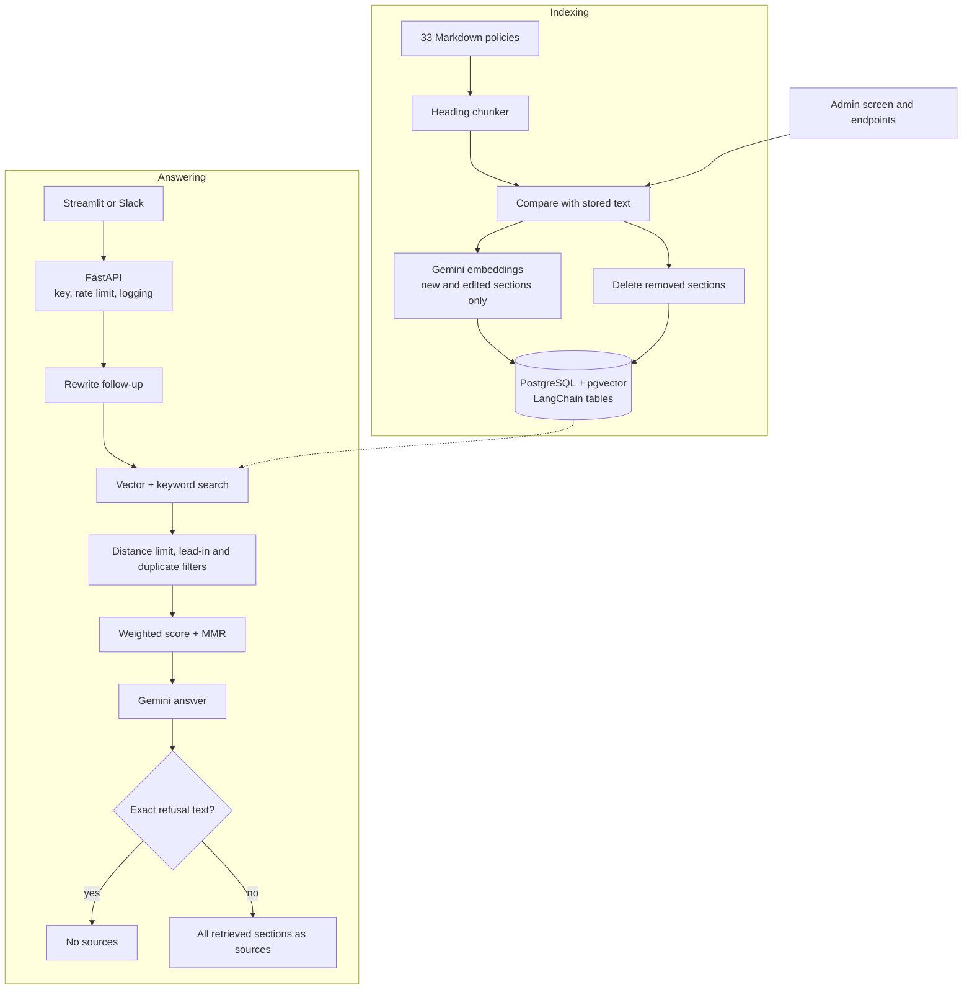
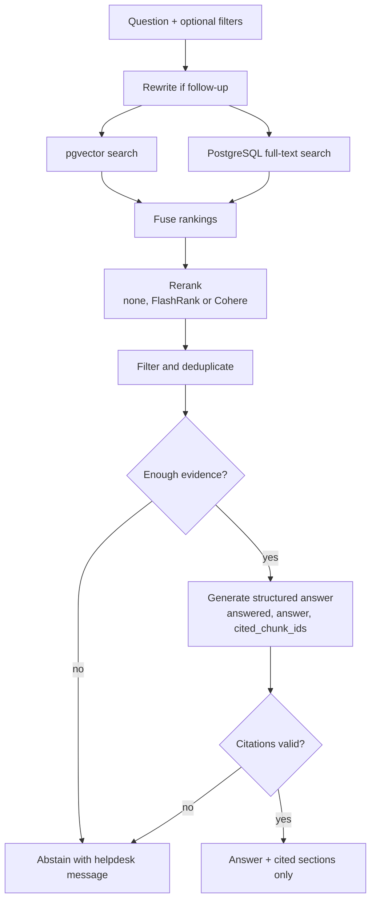
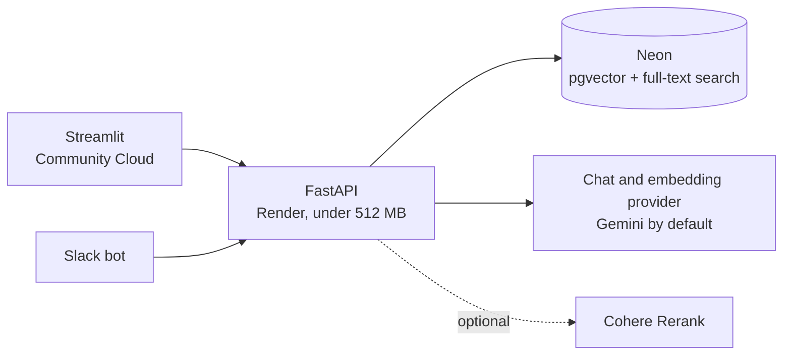
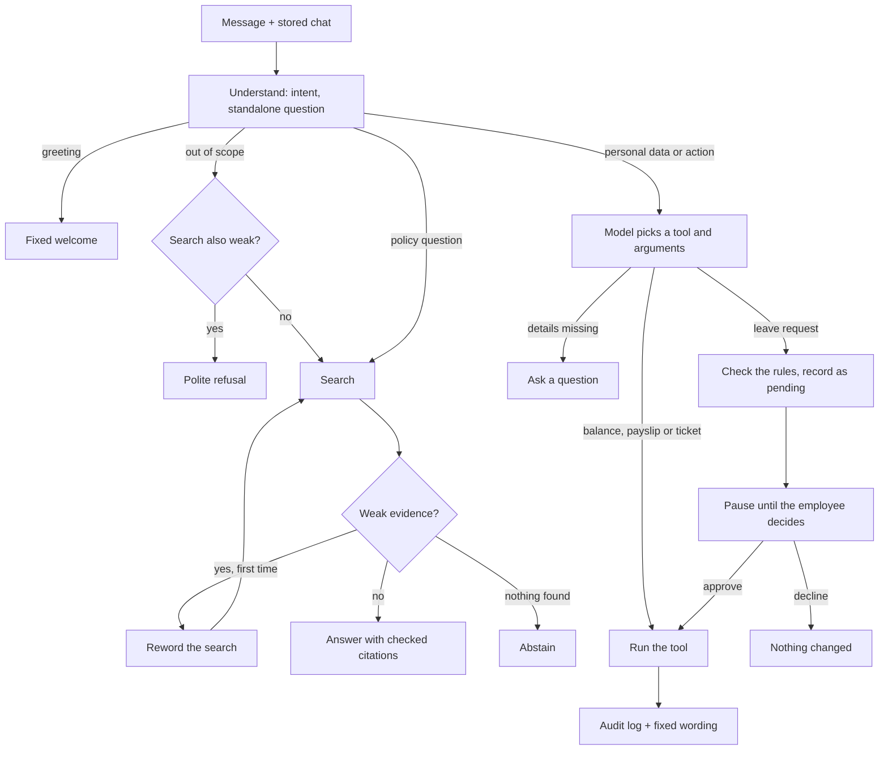

# Architecture

This describes the code as audited at commit `c93bac2`, then where Phase 1 and later phases take it.
For what's actually finished, see [ROADMAP_AND_STATUS.md](ROADMAP_AND_STATUS.md).

## Audit baseline (commit c93bac2, 5 November 2026)

| Check | Result |
|---|---|
| Automated tests | 116 passed, no API calls |
| `ruff` | 13 findings under the audit's first settings, none blocking |
| `mypy` | Could not run until package paths were configured |
| `pip-audit` on the API requirements | No known vulnerabilities |
| Facts in answers, keyword check | 20 / 20 |
| Correct refusals | 5 / 5 |
| Right policy file retrieved | 20 / 20 |
| RAGAS faithfulness, context recall, context precision | 1.000, 1.000, 0.890 |
| Docker | Not installed on the development PC, so container files can't be run there |

### Is the old evaluation a real measure?

Only partly:

- **Labels are at file level.** The old chunking also scored 20 / 20, so this check can't separate good retrieval from bad.
- **The set is small and easy.** There are 25 questions, mostly single facts, and no follow-up, multi-hop or conflict cases.
- **The answerer grades itself.** RAGAS was judged by the same Gemini model that writes the answers.
- **Thresholds were tuned on the test data.** The 0.42 distance limit and the keyword and reranker weights were chosen using questions that also measure them.
- **Latency wasn't measured.**

## Current architecture

### Audit findings

| Area | Finding | Severity |
|---|---|---|
| Configuration | Company name, HR email, branding, models and thresholds were hardcoded | High |
| Abstention | One distance limit, measured on 13 questions and tied to one embedding model | High |
| Answers | Refusal detected by exact string match | High |
| Citations | Sources list everything retrieved, not what the answer used | High |
| Evaluation | See above | High |
| Schema | Only LangChain's tables, with no migrations or `tenant_id` | Medium |
| Metadata | Version and effective date are dropped by the chunker, and there's no category | Medium |
| Dependencies | `requirements.txt` was only partly pinned | Medium |
| CI | Tests only, with no lint, types or vulnerability scan | Medium |
| Security | One shared API key, no user identity, in-memory rate limits | Medium (Phase 4) |
| Performance | Sequential scan of all vectors, and `to_tsvector` computed per row on each search | Low at 539 chunks |
| Docs | The intern guide names `router.py` and `tests/integration/`, which don't exist | Low |

### Component decisions

| Component | Decision | Reason |
|---|---|---|
| Heading chunker | Keep, extend | Best part of the system. Now also records version, effective date and category |
| LangChain `PGVector` tables | Keep | Working, and replacing them would mean re-embedding 539 chunks for no gain |
| FastAPI app and API key | Keep | Clean. Phase 4 adds real identity |
| Fixed distance limit | Keep as an option, add a confidence score | Tied to one embedding model, but needed for comparison |
| Weighted fusion + MMR | Keep as an option, add RRF | The brief's target flow uses RRF, and the choice should come from measurement |
| Exact-string refusal | Replace | Structured output is more reliable |
| Sources list | Replace | Only validated citations should appear |
| `app/config.py` constants | Refactor | Validated with Pydantic Settings, and the rest of the code keeps its names |
| Keyword evaluation and RAGAS | Keep, extend | Still useful, but too weak alone |
| `mini_rag.py` | Keep | Small, and documents how the project started. Not used by the app |
| Intern guide | Keep | Historical build guide. Marked as such in the README |

## Target architecture

## Phase 2 workflow

The server decides who the employee is, not the model, and a request for information can never use a tool that changes records. A finished run leaves no checkpoint, so chats live only in the conversation tables.

Later phases add richer document management (Phase 3), organisations, login and Row-Level Security (Phase 4), and observability (Phase 5).
