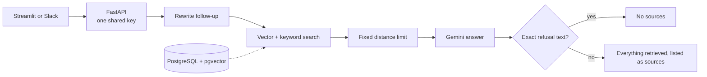
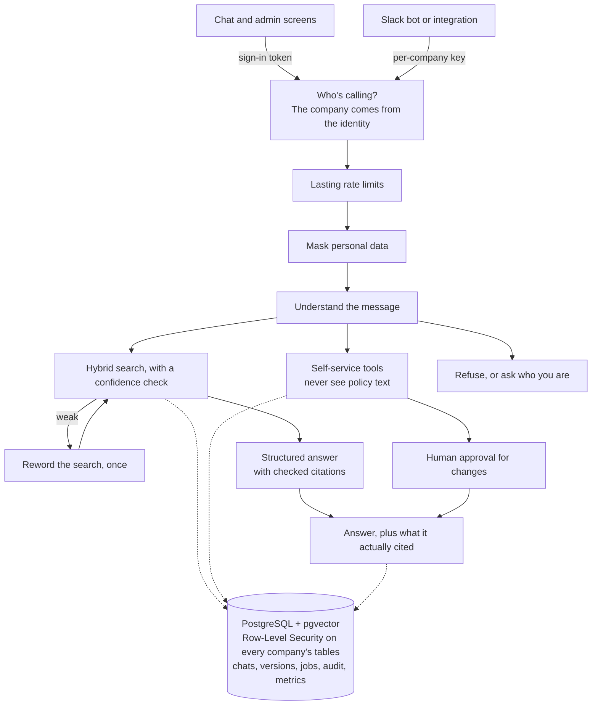

# HR Policy Assistant: final report

Covers the audit and Phases 1 to 5, as of 7 November 2026. Phase 6 is optional and hasn't been started.

## Summary

**The project went from a single-company demo to a tested multi-company platform, but it isn't production ready yet.** It has
never been deployed in this form, so everything here was measured on one Windows PC with an embedded database.

| Question | Answer |
|---|---|
| Does it work? | Yes, on sample data, on this PC, with the real model |
| Can one company reach another's data? | Not in any test, including checks at the database level and crafted prompts |
| Are the answers good? | Recall 0.938, citations 100% valid, judge rated 100% correct, all on labels not yet reviewed |
| Is it fast enough? | **No.** p95 is 10.78 s against a target of 6 s, and most of that is model time |
| Does it always refuse when it should? | **No.** 92.3% against a target of 100%, though one of the two misses is probably a wrong label |
| Can it carry real use on the free tier? | **No.** In a small test, 3 active people hit Gemini's rate limit, and 8 of 29 questions failed |
| Is it ready for real employee data? | **No.** See "Before real employee data" |

**The most useful next step is to deploy what's built and test it on Render and Neon,** not to add features.

All this work is on the branch `phase-5-observability`, which is on GitHub and holds every phase, and **CI passes there**. It
hasn't been merged, so the live app still runs the old code from `main`.

## Original and new architecture

### Original, at commit `c93bac2`

One hardcoded company and one shared key, with no user identity, no database migrations, and rate limits lost on restart.
It was evaluated on 25 easy questions, with labels at file level, and the model graded its own answers.

### New

| Area | Original | New |
|---|---|---|
| Companies | One, hardcoded | Many, with data kept apart by the database |
| Identity | One shared key | Sign-in, roles and per-company keys. Shared keys remain in demo mode |
| Answer flow | One fixed pipeline | LangGraph workflow that routes to policy answers, tools or refusals |
| Refusing | Matching an exact sentence | Confidence check, and a structured answer from the model |
| Citations | Everything retrieved | Only what the answer used, checked against what was sent |
| Conversations | Sent by the caller each time | Stored per user, with summaries, retention and deletion |
| Self-service | None | Mock HR system, with leave, payslip, tickets and approval |
| Policies | Markdown files and a script | Upload PDF, DOCX, TXT, HTML or Markdown, with versions, jobs and retries |
| Models | Mostly fixed | Set by configuration, with an optional fallback |
| Personal data | Not handled | Masked before storage, logs and the model |
| Evaluation | 25 easy questions, self-graded | 123 + 58 questions, chunk labels, a separate judge and a quality gate |
| Operations | Basic logs | JSON logs, metrics, optional tracing, load test, backup and restore |

## Features and their status

From [ROADMAP_AND_STATUS.md](ROADMAP_AND_STATUS.md), which has the evidence for each feature:

| Phase | Implemented and tested | Implemented, not tested | Partial | Planned |
|---|---:|---:|---:|---:|
| 1. Foundation and retrieval | 18 | 2 | 2 | 1 |
| 2. Memory and agent workflow | 15 | 0 | 1 | 0 |
| 3. Knowledge management and models | 16 | 3 | 3 | 1 |
| 4. Tenancy and security | 9 | 1 | 3 | 0 |
| 5. Observability and deployment | 4 | 3 | 3 | 0 |
| Earlier work | 3 | 1 | 2 | 0 |
| **Total: 91 features** | **65** | **10** | **14** | **2** |

**Everything not fully tested, by reason:**

| Reason | Features |
|---|---|
| Needs a service only the owner can set up | Real sign-in, Cohere, a second model provider, Slack, Langfuse, Redis |
| Needs a hosted deployment | Neon and Render, including restore, memory and the upgrade path |
| Tooling not available on this PC | Starting the Docker containers, following the guides on Linux and macOS, the AWS and GCP guide |
| Only partly checked in a browser | Upload form, some admin buttons, thumbs up and down, the newer admin tabs |
| Waiting for owner review | Golden set and agent set labels |
| Not built | OCR for scanned PDFs, which was left out on purpose to save memory, and rewording vague questions, which moved to the retry step |

## Technology choices

The full reasoning, with options and trade-offs, is in [DECISIONS.md](DECISIONS.md), entries D1 to D35.

| Need | Choice | Why |
|---|---|---|
| Vector and keyword search | PostgreSQL with pgvector and full-text search | One database does it all, and it fits free hosting |
| Workflow | LangGraph | Routing and pausing for approval, with state that survives a restart |
| Tenant isolation | PostgreSQL Row-Level Security, per transaction | A forgotten filter can't leak data, and it's safe behind a connection pooler |
| Sign-in | OpenID Connect, with tokens checked by PyJWT | No passwords stored, and the API decides who someone is, not a screen |
| Search method | Weighted vector and keyword scores, with MMR | Measured best. RRF and a topic filter were built, measured worse, and left off |
| Reranking | None by default | FlashRank raised recall very little for extra memory and time |
| Abstaining | Confidence measured across the company's chunks | A fixed distance limit is tied to one embedding model |
| Rate limits | PostgreSQL, or Redis if set | Every deployment already has PostgreSQL, and limits survive restarts |
| Metrics | Rows in PostgreSQL | The free stack has nowhere to run a metrics service |
| Personal data | Masked before anything else happens | One place to mask means no path can forget |
| Prompt injection | Limit what the model can do | No prompt wording reliably stops injection, so the design assumes it can succeed |
| Load test | Locust, with a simulated model | The free tier allows 500 model calls a day |
| Hosting | Render, Neon and Streamlit Cloud | Free, with a 512 MB limit, so no PyTorch in the API |

## Test results

| Check | Result |
|---|---|
| Automated tests | **614 pass** on GitHub, on Linux with PostgreSQL 16, and on Windows. The audit started at 116 |
| Ruff, mypy, quality gate | Pass on GitHub |
| pip-audit | No known vulnerabilities, including the optional requirements when run locally |
| Docker | **The images build on GitHub.** The containers have never been started |

**Passing tests didn't catch everything.** Real runs found bugs that tests with a fake model passed: usage counting broke every
question in Phase 5, and earlier phases had similar cases. That's why each phase also ran on the real model.

**The first CI run also found a real bug.** A restore failed when the PostgreSQL client tools were newer than the database,
which didn't show on this PC, where they match. It could have happened on Neon at the worst time, during a recovery. It's fixed.

## Evaluation results

**All labels are drafts, written by me and not yet reviewed by the owner: 0 of 123 golden and 0 of 58 agent questions are approved.
So every number here is provisional.** Each run is one sample, and the model isn't fully repeatable.

| Measure | Original | Phase 1 | Phase 2 | Phase 3 | Phase 4 | Phase 5 | Target |
|---|---:|---:|---:|---:|---:|---:|---:|
| Recall@5 | – | 0.947 | 0.938 | 0.943 | 0.943 | **0.938** | ≥ 0.90 |
| Expected facts (87) | 0.943 | 0.966 | 0.931 | 0.943 | 0.954 | **0.966** | – |
| Correct refusals (26) | 96.2% | 96.2% | 88.5% | 96.2% | 92.3% | **92.3%** | 100% |
| Wrongly refused | 4.1% | 1.0% | 3.1% | 3.1% | 3.1% | **3.1%** | – |
| Citations valid | 100% | 100% | 98.9% | 100% | 100% | **100%** | ≥ 95% |
| Citations on a labelled chunk | 98.9% | 96.9% | 95.7% | 96.8% | 96.8% | **95.7%** | – |
| Judge: faithful | 100% | 100% | 100% | 100% | 100% | **100%** | – |
| Judge: correct | 100% | 100% | 96.9% | 97.9% | 97.9% | **100%** | – |

- **Original vs Phase 1:** the original's citation figures aren't like for like, because it listed everything retrieved as a source.
- **Phase 1 is the search pipeline alone,** and Phases 2 to 5 go through the workflow.
- **Agent test:** 100% on intent, route, tool choice, tool success, approvals and leave details, on 58 questions. It's a small set.
- **Search-only recall** fell from 0.947 in Phase 1 to 0.933 when re-measured in Phase 4. Row-Level Security made no difference to the
  results. Some change in Phases 2 or 3 caused it, and it wasn't traced.

### Remaining failures in Phase 5

| Question | What happened | What it needs |
|---|---|---|
| `unanswerable-009` Friday dress code | Answered | **Probably a wrong label**, as the Code of Conduct seems to answer it. Owner's decision |
| `ambiguous-006` "How long do I have to raise it?" | Assumed a grievance | A real miss: it should ask what "it" means |
| `normal-054` When do I sign the NDA? | Refused | A real miss: it's in the onboarding checklist |
| `ambiguous-008`, `follow_up-009` | Refused | Real misses, on answerable questions |
| `conflict-001`, `conflict-002` | Gave one policy's figure | The policies disagree: see below |
| `exception-008` | The answer was right, but the check failed | The expected phrase looks too strict. Owner's decision |

### Contradictions in the sample policies

The owner needs to decide these. The bot can't.

| Question | One source | Another source |
|---|---|---|
| Sick leave on probation | Leave Policy: 12 days | Probation Policy: up to 6 days |
| Casual leave on probation | Leave Policy: 6 days | Probation Policy: up to 3 days |
| Referral bonus, non-technical Band 2 | Referral Policy: Rs. 15,000 | Compensation Policy: Rs. 20,000 |
| Time to raise a salary query | Payroll Policy and FAQ: 30 days | Compensation Policy: 5 working days |
| ESOP vesting | Summary: 4 years | The section's schedule runs to Year 5 |

## Performance

**Answer time** with the real model, measured by the evaluation:

| | Original | Phase 1 | Phase 2 | Phase 3 | Phase 4 | Phase 5 | Target |
|---|---:|---:|---:|---:|---:|---:|---:|
| Median seconds | 2.10 | 5.21 | 4.32 | 3.82 | 3.58 | **4.36** | – |
| p95 seconds | **3.54** | 19.52 | 8.58 | 8.08 | 7.29 | **14.87** | < 6 |

**The original was faster, and it met the target.** It made one model call per question. The new design adds a step to understand
the message, structured output with checked citations, and sometimes a reworded search. That's the cost of its routing,
tools and stricter refusals, and this trade hasn't been revisited.

Phase 5's 14.87 s includes the script's 30-second waits after 4 Google errors, and Google was reporting high demand that day. The
app's own measure of successful answers gives a **p50 of 4.17 s and a p95 of 10.78 s**.

| Where the time goes | p50 ms | p95 ms |
|---|---:|---:|
| Model calls | 2,716 | 8,489 |
| Embedding the question | 729 | 1,350 |
| Search | 411 | 1,159 |
| Everything else | 157 | 223 |

**Load, with a simulated model on this PC:**

| Users | Requests a second | `/ask` p50 ms | `/ask` p95 ms | Failures | Peak memory MB |
|---:|---:|---:|---:|---:|---:|
| 1 | 0.15 | 3,300 | 5,500 | 0 | 174 |
| 5 | 0.64 | 3,800 | 5,800 | 0 | 177 |
| 10 | 1.06 | 3,800 | 16,000, not repeated in 3 more runs | 0 | 180 |
| 20 | 2.61 | 3,900 | 6,100 | 0 | 190 |
| 40 | 5.21 | 3,800 | 6,100 | 0 | 203 |
| 80 | 6.36 | 8,600 | 13,000 | 7 | 255 |

**Load, with the real model on the free tier:** 1 user had no failures in 6 questions. **3 users had 8 failures in 29**, on Google's rate limit.

**Memory:** at most 255 MB under load, on Windows, against a target of 450 MB on Render. **Not measured on Render.**

**Backup and restore:** 25 tables, 5,366 rows and 8.8 MB, in 5.0 s and 4.3 s. **Not run on Neon.**

## Security assessment

This is my own review, backed by tests. **No independent security review or penetration test has been done.**

| Risk | Protection | Evidence | What's left |
|---|---|---|---|
| One company reading another's data | The identity sets the company, stores refuse others, and Row-Level Security on 21 tables | Tests at every level, and a test that fails if a new table is unprotected | Someone with the database owner's login can see everything. Not run on Neon |
| Someone pretending to be another person | Signed tokens checked by the API, and an email is tied to one person on first sign-in | Forged, expired and wrong-audience tokens are refused | **Demo mode lets anyone with the shared key name any employee.** Not run with a real provider |
| Misuse of an API key | Hashed, revocable, one company each | Tests | A key can name any user in its company |
| Going beyond your role | Employee, HR admin and platform admin roles | Tests | A platform admin can add and suspend companies, but has no route to read inside one |
| Prompt injection | Tools never see policy text, identity never comes from the model, and changes need recorded approval | Scripted model, plus 10 adversarial questions refused by the real model | A poisoned policy could still produce a wrong answer, and only HR admins can upload. Poisoned documents weren't tried on the real model |
| Personal data leaking | Masked before storage, logs and the model | Tests, including failure logs | **Names and free-text addresses aren't caught.** Policy text isn't masked |
| Tampering with records | The app's database role can't change or delete audit entries | Tests | The database owner still can |
| Overuse | Limits per client, per company and overall, surviving restarts | 15 requests at once against a limit of 5 allowed exactly 5 | The default overall limit is too high for the free tier |
| Vulnerable dependencies | pip-audit | None known today | Only checked when it's run. CI will do that once pushed |
| Secrets | None in the repository, and `.env` is ignored | Checked in this work | API keys were changed several times during this work. Delete any you no longer need |

**India's DPDP Act:** notes are in [DPDP_NOTES.md](DPDP_NOTES.md). Retention and deleting chats are built. A privacy notice, a grievance
contact, breach handling and a full data export aren't. **No lawyer has reviewed the notes.**

## Known limitations

**Not proven:**
- It has never run on Render or Neon, in running Docker containers, or with a real sign-in provider.
- Results come from one PC, and a load test here doesn't predict a 512 MB server.
- Labels are unreviewed, so every quality number is provisional.
- The judge comes from the same vendor as the answering model, so their errors may not be independent.

**Known to fall short:**
- Correct refusals are 92.3%, and p95 speed is 10.78 s. Both miss their targets.
- The free tier can't carry real use: its daily limit ran out several times during this work, and 3 people hit its rate limit.
- An ID token lasts about an hour, and the person then signs in again.
- Indexing jobs run inside the API process, so a restart stops one, and it has to be retried. With several servers, one
  starting up can mark another's running job as failed.
- Nothing raises an alert, and backups have to be run by hand.
- Logs leave out error messages on purpose, which makes some failures harder to diagnose.
- OCR isn't built, so scanned PDFs are refused.
- Only Gemini and FlashRank have run live. The other providers have only been tested with fakes.

**Not investigated:**
- Why search-only recall fell from 0.947 to 0.933.
- A single search that took 12.8 s during one load test step.

## Recommended next steps

**1. Review what's built (owner)**
1. Approve or reject the golden and agent questions, starting with `unanswerable-009`, `adversarial-004` and `exception-008`.
2. Decide the five policy contradictions.

**2. Deploy and test it**
3. Take a backup of the live database, then merge into `main`. **That deploys to Render, and turns on the new security on Neon.**
4. Check the database role, the upgrade, memory and speed on the deployment. It stays in demo mode until step 6.
5. Run a backup and restore on Neon, and a small load test against the deployment.
6. Create a sign-in client, and try real sign-in with `AUTH_MODE=oidc`.

**3. Close the gaps found here**
7. Lower `RATE_LIMIT_TOTAL_PER_MINUTE` on the free tier, so people see "busy" rather than a failure.
8. Test a paid model tier for speed and rate limits. It's also needed before any real data.
9. Measure whether a faster path for clear questions can get close to 6 s without losing quality. The original managed
   3.54 s with one model call, so the understanding step is the first thing to test.
10. Fix the real misses: asking what an unclear "it" means, and `normal-054`.

**4. Before real employee data**
11. Work through the list at the end of [DPDP_NOTES.md](DPDP_NOTES.md), including legal advice.
12. Get an independent security review.
13. Connect a real HR system in place of the mock one.
14. Add alerts and scheduled backups.

**5. Optional: Phase 6**
Conflict detection would help with the contradictions above, and Hindi and Marathi would help employees directly. But Phase 6 adds
features, so it doesn't move the project closer to production. I'd do it after steps 1 and 2.
