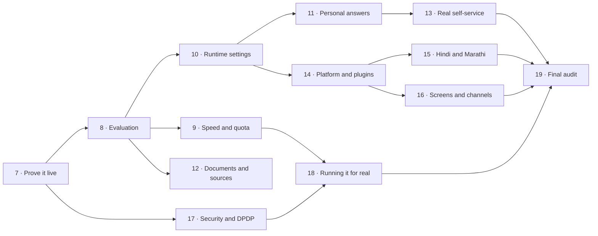

# Improvement plan: from 7.8 to 10/10

This plan turns the review of 9 November 2026 into phases of work. It follows the same rules as the
earlier phases in `hr_policy_assistant_master_prompt_v2.md`: one branch and one session per phase, the
owner approves each phase before the next starts, nothing counts as done until it's built **and**
tested, and every new technology gets an entry in `docs/DECISIONS.md` first.

**10/10 doesn't mean more features.** It means every area below is backed by evidence: a live
deployment, reviewed labels, measured numbers that meet their targets, and an honest list of what's
left. Several phases add features, but each one has to earn its place with a measurement.

## Contents

1. [What 10/10 means](#1-what-1010-means)
2. [Ground rules](#2-ground-rules)
3. [Order of the phases](#3-order-of-the-phases)
4. [Phase 7: Prove it live](#phase-7-prove-it-live)
5. [Phase 8: Evaluation you can trust](#phase-8-evaluation-you-can-trust)
6. [Phase 9: Speed and quota](#phase-9-speed-and-quota)
7. [Phase 10: Settings per organisation, changed while running](#phase-10-settings-per-organisation-changed-while-running)
8. [Phase 11: Answers for the person asking](#phase-11-answers-for-the-person-asking)
9. [Phase 12: Better documents and more sources](#phase-12-better-documents-and-more-sources)
10. [Phase 13: Real self-service](#phase-13-real-self-service)
11. [Phase 14: A platform, not just an HR bot](#phase-14-a-platform-not-just-an-hr-bot)
12. [Phase 15: Hindi and Marathi](#phase-15-hindi-and-marathi)
13. [Phase 16: Screens and channels](#phase-16-screens-and-channels)
14. [Phase 17: Security and DPDP](#phase-17-security-and-dpdp)
15. [Phase 18: Running it for real](#phase-18-running-it-for-real)
16. [Phase 19: Final 10/10 audit](#phase-19-final-1010-audit)
17. [Risks](#risks)
18. [What the owner must set up](#what-the-owner-must-set-up)

---

## 1. What 10/10 means

Each area has a score from the review, a target, and the evidence needed to claim it. A score only
goes up when the evidence exists and is linked from `docs/ROADMAP_AND_STATUS.md`.

| Area | Now | Target | Evidence needed for the target | Phases |
|---|---:|---:|---|---|
| RAG and retrieval | 8.5 | 10 | Recall@5 ≥ 0.95 and citations ≥ 98% on **reviewed** labels. Each retrieval change measured against the one before it | 8, 11, 12 |
| Agent workflow | 8 | 10 | A real HR system adapter behind the interface, manager approval, handoff to a person. Agent set ≥ 100 reviewed items, all scores ≥ 0.97 | 13 |
| Security and multi-organisation | 8 | 10 | Name and address masking, an injection classifier, MFA, email verification, a written threat model, a security scan in CI, RLS checked on Neon | 7, 17 |
| Evaluation | 8 | 10 | Owner-reviewed labels, a judge from another vendor, a real-model run every night, feedback turned into new test items | 8 |
| Testing and CI | 9 | 10 | Coverage reported and enforced, end-to-end browser tests in CI, the containers started in CI, not only built | 7, 16 |
| Documentation | 9 | 10 | Every doc matches the code, a runbook per alert, a 3-minute demo video linked from the README | 18, 19 |
| UI | 6.5 | 10 | An embeddable chat widget, WCAG 2.2 AA checked, a translated UI, phone layout tested, Teams as a second channel | 15, 16 |
| Performance and scale | 5 | 10 | p95 < 6 s warm **on the deployment**, 20 people at once without failures, API memory < 450 MB on Render | 9, 18 |
| Deployment and operations | 6 | 10 | Running on Render, Neon and Streamlit, with scheduled backups, restore tested on Neon, alerts and a status page | 7, 18 |
| Versatility | not scored | 10 | A second domain (IT Support) running from a domain pack with no core code changes. Providers, tools and stores added as plugins | 10, 14 |

**The free-tier limits still apply.** Where a target can't be met on free tiers, such as latency under
real load on Gemini's free quota, the phase reports the real number, says why, and shows the paid or
self-hosted setting that would meet it. Targets are never met by changing the test set.

## 2. Ground rules

These carry over from the master prompt, with three additions for this plan.

1. One branch per phase, named `phase-<n>-<topic>`, with small commits.
2. One phase per session. Report, then wait for approval.
3. Paid services and credentials sit behind settings, with a fake for tests, and are off by default.
4. A technology is added only after its entry in `docs/DECISIONS.md`.
5. The API image stays free of PyTorch. Heavier models run in an optional worker or a hosted API.
6. Sample data only on the free Gemini tier.
7. Never invent numbers. Report regressions as plainly as gains.
8. **New:** every phase starts by running the evaluation on the current code, so its own changes are
   measured against a fresh baseline, not an old report.
9. **New:** every phase ends with `docs/ROADMAP_AND_STATUS.md` updated, and the score table in section 1
   of this file updated with links to the evidence.
10. **New:** a feature that is measured worse stays off by default, as RRF and category routing already
    are, and its result is recorded in `docs/DECISIONS.md`.

Each phase below lists: its goal, why it matters, the work, the files most likely to change, any new
technology, the tests, what "done" means, and what the owner has to do. Effort is shown as **S** (one
session), **M** (one to two sessions) or **L** (two or more sessions, split into parts).

## 3. Order of the phases

Proving what exists comes first, because the review's biggest gap is that nothing has run deployed.
Evaluation comes second, because every later phase is judged by it. Speed comes third, because it's
the target that fails today. The rest build on those three.

| Phase | Topic | Effort | Score areas moved |
|---|---|:-:|---|
| 7 | Prove it live | M | Deployment, Testing, Security |
| 8 | Evaluation you can trust | M | Evaluation, RAG |
| 9 | Speed and quota | M | Performance |
| 10 | Settings per organisation, changed while running | M | Versatility |
| 11 | Answers for the person asking | M | RAG, Agent |
| 12 | Better documents and more sources | L | RAG, Versatility |
| 13 | Real self-service | L | Agent |
| 14 | A platform, not just an HR bot | L | Versatility |
| 15 | Hindi and Marathi | M | UI, RAG |
| 16 | Screens and channels | L | UI, Testing |
| 17 | Security and DPDP | L | Security |
| 18 | Running it for real | M | Deployment, Performance, Documentation |
| 19 | Final 10/10 audit | S | All |

Phases 9, 10, 12 and 17 don't depend on each other, so they can run in separate sessions at the same
time once Phase 8 is approved, as long as each stays on its own branch and its own files.

---

## Phase 7: Prove it live

**Goal:** the code that's built runs on Render, Neon and Streamlit Community Cloud, and the numbers in
the final report are measured there, not only on one PC.

**Why:** the final report's own advice is to deploy before adding features. Every later phase is easier
to judge against a real deployment.

**Progress:** part 1, the checks and the CI job, is built and tested locally. Part 2, the live run, waits
for the owner. See [the Phase 7 report](../evaluation/reports/phase7_report.md).

**Work**

- [ ] Merge the finished phase branches into `main` in order, following `DEPLOY.md`, after the owner
      approves. Run the Alembic upgrade on Neon and record each step.
- [ ] Check that the app's database role on Neon can't bypass Row-Level Security, and run the tenant
      isolation tests against Neon with a throwaway branch database.
- [ ] Deploy the API to Render and the chat screen to Streamlit Community Cloud. Record cold start time
      and memory with `/health` and Render's metrics.
- [ ] Start the Compose stack in CI, not just build it: `docker compose up -d`, wait for `/live`, call
      `/ask` with a scripted model, then tear it down.
- [ ] Run a real OIDC sign-in with a Google client the owner creates.
- [ ] Run a backup and restore against Neon with `ops/backup.py`.
- [ ] Run the Locust test against the deployment with the simulated model, then a small sample with the
      real model, and record both.
- [ ] Run the Slack bot once with a real workspace, if the owner wants it, or mark it clearly as
      untested.

**Files:** `.github/workflows/ci.yml`, `DEPLOY.md`, `docs/DEPLOY_CLOUD.md`, `docs/OPERATIONS.md`,
`render.yaml`, `evaluation/reports/`.

**New technology:** none.

**Tests:** a new CI job, `compose-smoke`, that starts the stack and makes three requests.

**Done when**

- The live chat screen answers a policy question with citations, refuses an off-topic one, and keeps
  two test organisations apart.
- Memory on Render, cold start, p50 and p95 latency on the deployment are written in
  `evaluation/reports/phase7_live.md`, whether or not they meet the targets.
- A restore from a Neon backup has been run and timed.

**Owner:** approve the merge, create a Google OIDC client, give Neon and Render access, and optionally
Slack tokens.

---

## Phase 8: Evaluation you can trust

**Goal:** the evaluation measures the right things on labels the owner has approved, runs on a
schedule with the real model, and grows from real feedback.

**Why:** every current result carries the warning "draft labels". Later phases can't claim gains on
labels nobody has checked.

**Work**

- [ ] Build a small review screen in the admin page, or a script that writes a spreadsheet, so the
      owner can mark each golden and agent item `approved` or `rejected` quickly, with the cited chunk
      shown beside the question.
- [ ] Settle the open questions in the Phase 5 report: `adversarial-004`, `unanswerable-009` and the
      five policy contradictions.
- [ ] Grow the golden set to 200 items and the agent set to 100, filling the thin categories: multi-hop,
      conflicting policies, exceptions, follow-ups and injection attempts. New items stay `draft` until
      reviewed.
- [ ] Use a judge from another vendor. Claude through `langchain-anthropic` is the first choice, or a
      local Ollama model if no key is given. Keep the Gemini judge as a second opinion and report how
      often they agree.
- [ ] Add faithfulness and answer relevance scores alongside the existing fact checks, written in the
      project's own code or with RAGAS if its entry in `DECISIONS.md` shows it's worth the dependency.
- [ ] Add a scheduled GitHub Actions workflow that runs the full evaluation with the real model every
      night on `main`, using a repository secret, and commits nothing: it uploads the report as an
      artifact and fails on a regression.
- [ ] Make thumbs-down answers and unanswered questions show up in the admin page as "add to test set",
      which creates a draft item with the question, the answer and the chunks it saw.
- [ ] When a policy is uploaded, generate draft test questions for its new sections, to be reviewed.
- [ ] Report coverage with `pytest-cov` and fail CI below the current level.

**Files:** `evaluation/`, `ui/pages/admin.py`, `app/admin.py`, `.github/workflows/`,
`requirements-dev.txt`.

**New technology:** `pytest-cov`; possibly RAGAS (decision first); a scheduled workflow.

**Tests:** the review tool, the feedback-to-draft step and the judge agreement code all have unit
tests with fakes.

**Done when**

- At least 90% of golden and agent items are approved or rejected by the owner.
- The nightly run has passed three nights in a row, with its reports kept as artifacts.
- `evaluation/reports/phase8_report.md` gives every metric on approved items only, next to the old
  draft-label numbers, including anything that got worse.

**Owner:** review the labels (the biggest single task in this plan), and add a judge API key if
another vendor is wanted.

---

## Phase 9: Speed and quota

**Goal:** p95 under 6 seconds warm on the deployment, and enough headroom on the free quota for at
least 10 active people.

**Why:** latency and quota are the two targets that fail today. Most of the time is model calls:
`understand` (which already combines intent and rewriting in one call) and then the answer, plus a
second search when evidence is weak.

**Work**

- [ ] Measure first: add per-step timings for `understand`, embedding, search, retry and answer to the
      metrics table, and record a breakdown on the deployment.
- [ ] Skip `understand` for simple first messages. A first message with no history that a cheap check
      marks as a clear policy question goes straight to search. Measure intent accuracy on the agent set
      before keeping it on.
- [ ] Start the search on the raw question while `understand` runs, and keep it if the standalone
      question comes back the same. This hides most of the embedding and search time.
- [ ] Let `understand` use a smaller or local model than the answer, with its own setting
      (`ROUTER_MODEL`), so it's fast and doesn't use the answer model's quota.
- [ ] Cache question embeddings in PostgreSQL, keyed by organisation, model and text hash.
- [ ] Add an answer cache for repeated questions. It's keyed by organisation, the standalone question's
      embedding, and the set of current document versions, so an upload clears it. It only serves answers
      that passed the citation check, and only within a similarity it was measured to be safe at. It's
      off for questions that use personal data.
- [ ] Make the request path async from the API to the model calls, so one slow call doesn't hold a
      worker.
- [ ] Tune `LLM_MAX_TOKENS` and the prompt length, and record the effect on answer quality.

**Files:** `app/workflow.py`, `app/agent/graph.py`, `app/rag/service.py`, `app/rag/store.py`,
`app/config.py`, `app/main.py`, a new migration for the caches, `app/metrics.py`.

**New technology:** none beyond PostgreSQL tables. Async model calls use what LangChain already offers.

**Tests:** cache clearing on upload, cache isolation between organisations, and the no-cache rule for
personal data. The fast path must give the same intent as `understand` on the agent set.

**Done when**

- p95 on the deployment, with the real model, is under 6 seconds warm, or the report shows the
  breakdown and the setting that gets there on a paid tier.
- The golden set's quality numbers are the same or better with every speed change turned on.
- A load test with 10 simulated people at once on the real model finishes with no quota errors.

**Owner:** decide whether a paid tier or a second free key for the router model is acceptable.

---

## Phase 10: Settings per organisation, changed while running

**Goal:** each organisation's settings live in the database and can be changed from the admin page
without a redeploy.

**Why:** today most settings are environment variables shared by every organisation, and branding
comes from `config/tenant.toml`. A platform needs each organisation to set its own.

**Work**

- [ ] A `tenant_settings` table with Row-Level Security, holding a validated Pydantic model: branding,
      HR email, categories, model choice, retrieval thresholds, refusal wording, tone, answer length and
      feature switches such as self-service.
- [ ] Settings are read through one function that falls back to the environment and then to the
      defaults, with a short cache that's cleared when a setting changes.
- [ ] A Settings tab in the admin page, with validation and an audit log entry for each change.
- [ ] Keep `tenant.toml` as the seed for a new organisation, imported once.
- [ ] Assign a category to each uploaded document with the model, from the organisation's own list,
      shown to HR as a suggestion they confirm. This replaces the filename map.
- [ ] Changing a setting that needs re-indexing, such as the embedding model, starts a re-index job
      instead of breaking search.

**Files:** `app/config.py`, `app/tenancy.py`, `app/knowledge.py`, `app/admin.py`, `ui/pages/admin.py`,
a new migration.

**New technology:** none.

**Tests:** one organisation's settings never apply to another; invalid values are refused; a change is
picked up without a restart; the audit log records it.

**Done when** two organisations on the same deployment have different branding, models and thresholds,
set from the admin page, and the isolation tests still pass.

---

## Phase 11: Answers for the person asking

**Goal:** answers reflect who is asking: location, grade, type of employment and probation status.

**Why:** many HR rules depend on who you are. "Can I work from home?" has a different answer on
probation. This is the improvement employees would notice most.

**Work**

- [ ] Add "applies to" details to each section when it's indexed: locations, grades, employment types,
      probation. They're extracted by the model once per changed section, shown to HR to confirm, and
      stored as metadata.
- [ ] Read the asker's attributes from their profile or the HR system adapter. Never ask the model for
      them.
- [ ] Search prefers sections that apply to the asker, without hiding the general rule. The answer says
      which group a rule is for ("For employees on probation…").
- [ ] Add 30 or more golden items that need a persona, each run as two different employees.
- [ ] Let the employee see and correct which attributes were used.

**Files:** `pipeline/chunk_documents.py`, `app/knowledge.py`, `app/rag/retrieval.py`,
`app/rag/store.py`, `app/rag/prompt.py`, `app/identity.py`, `app/agent/hrms.py`, `evaluation/data/`.

**New technology:** none.

**Tests:** persona filters on real SQL; one employee's attributes never reach another's request;
attributes are masked in logs.

**Done when** the persona items score at least as well as the general ones, and the general set
doesn't get worse.

---

## Phase 12: Better documents and more sources

**Goal:** the knowledge base handles real-world documents and stays in sync with where HR keeps them.

**Why:** HR documents are scanned PDFs, tables and SharePoint folders, not neat Markdown.

**Work, part A: reading documents**

- [ ] Use DOCX heading styles for sections instead of guessing.
- [ ] Extract PDF tables as Markdown tables with `pdfplumber` (no PyTorch). Measure it on sample
      policies with tables.
- [ ] OCR for scanned PDFs as an optional worker, either Tesseract in its own container or Google
      Document AI behind a setting. It stays off on the free API.
- [ ] Docling as an optional, local-only extractor, compared with the default on the same documents.
- [ ] A side-by-side view in the admin page of the original page and the extracted sections, so HR can
      check them before publishing.

**Work, part B: retrieval experiments (keep only what wins)**

- [ ] Small-to-big retrieval: search small pieces, send the whole section.
- [ ] Contextual headers: a one-line summary of the document added to each chunk before embedding.
- [ ] Query decomposition for multi-part questions.
- [ ] Each one is measured on approved labels against the current setup and recorded in
      `DECISIONS.md`, kept on or off by the result.

**Work, part C: sources and changes**

- [ ] A `Connector` interface with list, fetch and "changed since". First connectors: a watched folder
      and Google Drive. SharePoint through Microsoft Graph behind a setting, with a fake.
- [ ] Sync on a schedule through the existing job table, using the existing content hashes so only
      changed sections are embedded.
- [ ] Find contradictions between policies at upload time: compare new sections with similar existing
      ones and flag clashes for HR. The five known contradictions are the test cases.
- [ ] Write a plain summary of what changed when a policy gets a new version, and show it in the admin
      page and, optionally, to employees who asked about that policy before.
- [ ] Policy review dates, with a reminder in the admin page when one has passed.

**Files:** `pipeline/extract.py`, `pipeline/chunk_documents.py`, `app/knowledge.py`, a new
`app/connectors/` package, `app/rag/`, `ui/pages/admin.py`, migrations.

**New technology:** `pdfplumber`; optional Tesseract, Google Document AI, Docling and Microsoft Graph,
each with a decision entry.

**Done when** a scanned PDF and a PDF with tables can be uploaded and answered from correctly, a Drive
folder stays in sync, the five known contradictions are flagged, and each retrieval experiment has a
recorded result.

---

## Phase 13: Real self-service

**Goal:** the agent works with a real HR system's API, with approvals that match how companies work.

**Why:** the mock HR system proves the design, but a 10/10 agent has to work against a real API with
real failures.

**Work**

- [ ] Turn `MockHRMS` into an `HRMS` protocol that the mock and real adapters both follow, with typed
      results and the existing `HRMSRejected` and `HRMSUnavailable` errors.
- [ ] One real adapter against a free developer sandbox. BambooHR or Zoho People are likely choices,
      decided with the owner. Recorded responses are used in tests.
- [ ] Manager approval: the employee asks, the manager approves or rejects, and the employee is told.
      Approval chains come from the HR system, not from the chat.
- [ ] Notifications by email (SMTP, with a fake in tests) and Slack, through one `Notifier` interface.
- [ ] New tools, each with a schema, fixed reply wording, audit logging and agent-set items:
      reimbursement claim, attendance correction, holiday calendar, request an employment letter, and
      asset request.
- [ ] Handoff to a person: "talk to HR" raises a ticket with a masked summary of the chat and the
      sources it saw, and the employee can follow its status.
- [ ] Idempotency keys on every tool that changes something, so a retry never applies twice.

**Files:** `app/agent/`, `app/workflow.py`, a new `app/notify.py`, `ui/streamlit_app.py`,
`evaluation/data/agent_set.json`, migrations.

**New technology:** the chosen HR system's API; SMTP. Decision entries first.

**Done when** the agent set has at least 100 approved items, scores at least 0.97 on each measure, and
a full leave request with manager approval has run against the sandbox.

**Owner:** pick the HR system and create a sandbox account.

---

## Phase 14: A platform, not just an HR bot

**Goal:** the same code serves a second domain, IT Support, from configuration and a domain pack, and
other agents can use it through MCP.

**Why:** this is the clearest proof that the design is reusable, and it's in the master prompt's
Phase 6.

**Work**

- [ ] A **domain pack** format: a folder with prompts, refusal wording, categories, tools, sample
      documents and an evaluation set. HR becomes the first pack. Nothing HR-specific stays in `app/`.
- [ ] An IT Support pack with about 15 sample documents (VPN, laptop, passwords, software requests), one
      tool (raise an IT ticket), and a 60-item evaluation set.
- [ ] Plugins through Python entry points for chat and embedding providers, rerankers, tools, connectors
      and vector stores. The current dictionaries in `app/rag/providers.py` and `app/rag/rerank.py`
      become the built-in plugins.
- [ ] A `VectorStore` protocol that the pgvector store follows, so another store could be added later
      without changes elsewhere. Only pgvector is built and supported.
- [ ] An MCP server that offers `search_policies`, `ask_policy` and `raise_ticket`, using a
      per-organisation API key and the same rate limits and isolation as the API.
- [ ] Add Amazon Bedrock and Azure OpenAI as provider plugins, tested with fakes, since many companies
      can only use those.

**Files:** `app/` (moving HR-specific parts), a new `domains/` folder, `app/rag/providers.py`,
`app/rag/rerank.py`, `app/agent/tools.py`, a new `app/mcp_server.py`, `pyproject.toml`.

**New technology:** the MCP Python SDK; entry points. Decision entries first.

**Done when** an IT Support organisation and an HR organisation run side by side on one deployment,
each passes its own evaluation, a grep finds no HR wording in `app/`, and an MCP client such as Claude
Desktop can call the server.

---

## Phase 15: Hindi and Marathi

**Goal:** employees can ask in Hindi or Marathi, in their script or in Latin letters, and get an answer
in the same language with the same citations.

**Why:** the sample company is in India, and many employees are more comfortable in their own language.

**Work**

- [ ] Detect the question's language, and answer in it, while citing the English policy text.
- [ ] Check that the embedding model finds the right English sections for Hindi and Marathi questions.
      If it doesn't, translate the question for search only, and measure both.
- [ ] Use PostgreSQL's `simple` text search configuration alongside `english`, so keyword search
      doesn't drop non-English words.
- [ ] 60 Hindi and Marathi golden items, reviewed by a native speaker, including mixed-language
      questions.
- [ ] Translate the chat screen's fixed text, with the language chosen in Settings.
- [ ] Refusals and fixed replies in each language.

**Files:** `app/rag/store.py`, `app/rag/prompt.py`, `app/agent/prompts.py`, `ui/`, `evaluation/data/`,
a migration for the extra text search column.

**Done when** recall and citations in Hindi and Marathi are within 5 points of English on reviewed
labels, and refusals are just as reliable.

**Owner:** find a reviewer for Hindi and Marathi items.

---

## Phase 16: Screens and channels

**Goal:** the assistant can be used from a company's own website, Microsoft Teams, Slack and the chat
screen, and the screens meet accessibility standards.

**Why:** Streamlit is fine for admin work, but employees use the tools their company already has.

**Work**

- [ ] An embeddable chat widget: a small TypeScript web component served by the API, added to any page
      with one script tag. It uses the existing streaming API, sign-in tokens and citations.
- [ ] A Microsoft Teams bot using the Bot Framework, running like the Slack bot as a separate small
      service, with fakes in tests.
- [ ] Keep Streamlit for the admin pages and as a demo chat screen. Split `ui/streamlit_app.py` into
      smaller modules.
- [ ] Show the cited passage highlighted in the source document, opened from the citation.
- [ ] Suggested follow-up questions after an answer, taken from nearby sections.
- [ ] Analytics in the admin page: unanswered questions grouped by topic, with the policy gaps they
      point to, plus trends over time.
- [ ] WCAG 2.2 AA: run axe on every screen in CI and fix what it finds. Check keyboard use and screen
      reader labels by hand.
- [ ] End-to-end browser tests with Playwright in CI for sign-in, asking, citations, leave approval
      and the admin upload.

**Files:** a new `widget/` folder, `integrations/teams_bot.py`, `ui/`, `.github/workflows/ci.yml`,
`app/main.py` (static files and CORS per organisation).

**New technology:** TypeScript with a small build step, the Bot Framework SDK, Playwright and axe.
Decision entries first, including why it's a web component and not a full React app.

**Done when** the widget runs on a plain test page, the Teams bot answers in a test tenant, axe finds
no serious issues, and the Playwright tests pass in CI.

**Owner:** a Microsoft 365 developer tenant if Teams is wanted.

---

## Phase 17: Security and DPDP

**Goal:** the system is ready for a security review and the DPDP steps listed in
`docs/DPDP_NOTES.md` are built, not only documented.

**Why:** the review found masking that misses names and addresses, pattern-based injection checks, no
MFA and no email verification.

**Work**

- [ ] A written threat model in `docs/THREAT_MODEL.md`: assets, who might attack, entry points, and
      the control and test for each threat.
- [ ] Name and address masking with Microsoft Presidio and a small spaCy model, measured for memory.
      If it doesn't fit in 450 MB, it runs on the optional worker, and the API keeps the regex masking.
- [ ] A prompt-injection classifier on uploaded documents and questions, through a hosted API or the
      optional worker, adding to the existing fencing and tool isolation. Measured on the injection items
      in the golden set and a public injection test set.
- [ ] Email verification and password reset by email, through the `Notifier` from Phase 13.
- [ ] TOTP-based MFA with `pyotp`, required for HR admins and platform admins.
- [ ] SCIM 2.0 endpoints so a company directory can add and remove people automatically.
- [ ] DPDP features: consent recorded at sign-up, a "download my data" export, a deletion request that
      also clears caches and checkpoints, and a notice of what is stored and for how long.
- [ ] Security checks in CI: Bandit for code, Trivy for the images, Gitleaks for secrets, and an OWASP
      ZAP baseline scan against the Compose stack.
- [ ] Encrypt the most sensitive columns at rest with keys from the environment.

**Files:** `app/pii.py`, `app/guards.py`, `app/identity.py`, `app/passwords.py`, `app/accounts.py`,
a new `app/scim.py`, `docs/DPDP_NOTES.md`, `.github/workflows/ci.yml`, migrations.

**New technology:** Presidio, spaCy, `pyotp`, Bandit, Trivy, Gitleaks and ZAP. Decision entries first.

**Done when** every threat in the threat model has a test, the CI security jobs pass, the export and
deletion are tested end to end, and an outside reviewer has been offered the threat model.

**Owner:** legal advice on DPDP before any real employee data, as the notes already say.

---

## Phase 18: Running it for real

**Goal:** the deployment can be run by someone other than its author, with alerts, backups and
recovery that have been tested.

**Why:** operations is one of the two weakest areas, and it's what makes the rest trustworthy.

**Work**

- [ ] Move indexing jobs out of FastAPI `BackgroundTasks` into a PostgreSQL-backed queue with a separate
      worker, keeping the in-process runner as the free-tier default.
- [ ] OpenTelemetry traces across the API, workflow, model calls and database, sent to any OTLP
      backend, alongside the existing metrics table.
- [ ] Prometheus metrics at `/metrics`, and a Grafana dashboard checked into the repository.
- [ ] Service level objectives: availability, p95 latency, refusal rate and error rate, with alerts
      and a runbook for each in `docs/OPERATIONS.md`.
- [ ] Scheduled backups with a GitHub Actions cron job to private storage, and a monthly restore test
      that reports its result.
- [ ] A public status page, such as an uptime monitor on `/live`.
- [ ] Optional Terraform for the paid cloud setup in `docs/DEPLOY_CLOUD.md`, checked with
      `terraform validate` in CI.
- [ ] A load test on the deployment at 20 people at once, on the speed settings from Phase 9.

**Files:** `app/knowledge.py`, a new `app/jobs.py` and `worker.py`, `app/observability.py`,
`app/metrics.py`, `docs/OPERATIONS.md`, `.github/workflows/`, a new `infra/` folder.

**New technology:** a PostgreSQL job queue (such as procrastinate), OpenTelemetry, Prometheus client,
Grafana and Terraform. Decision entries first.

**Done when** a deliberate failure (the model down, the database restarted, a job crashing) raises the
right alert and is recovered by following the runbook, and the 20-person load test meets the p95
target or reports why not.

---

## Phase 19: Final 10/10 audit

**Goal:** an honest score for every area, with evidence.

**Work**

- [ ] Run every test, the full evaluation on approved labels, the load test and the security checks on
      the final code.
- [ ] Re-score each area in section 1, with a link to the evidence for each score. Where an area falls
      short of 10, say what's missing.
- [ ] Update `docs/FINAL_REPORT.md`, `docs/ARCHITECTURE.md` and the README, including new diagrams.
- [ ] Record a 3-minute demo: a question with citations, a refusal, a personal answer, a leave request
      with manager approval, a Hindi question, an upload with a flagged contradiction, and the IT Support
      domain.
- [ ] Remove anything that was built but measured worse and never turned on, or document why it's kept.

**Done when** the owner agrees with each score.

---

## Risks

| Risk | Effect | What to do |
|---|---|---|
| Label review takes the owner a long time | Phases 8 onwards can't claim gains | Build the review tool first, and review the most used categories first |
| Free Gemini quota | Latency and load targets can't be met | Report real numbers, offer the paid or self-hosted setting, and use caching |
| 512 MB on Render | Presidio, OCR or a reranker don't fit | Optional worker or hosted API, measured before turning on |
| Too much at once | Shallow work, as the master prompt warns | One phase at a time, each approved, and features that measure worse stay off |
| A sandbox HR system changes its API | Adapter breaks | Recorded responses in tests, and the mock stays the default |
| Scope of a second domain grows | Phase 14 drags on | IT Support pack kept to 15 documents and one tool |
| Real employee data used too early | Legal risk under DPDP | Sample data only until Phase 17 is done and legal advice is taken |

## What the owner must set up

| When | What |
|---|---|
| Phase 7 | Approve merging to `main`, Neon and Render access, a Google OIDC client, Slack tokens if wanted |
| Phase 8 | Review golden and agent labels, a second-vendor judge key if wanted |
| Phase 9 | Decide whether a paid tier or a second key for the router model is acceptable |
| Phase 13 | Choose the HR system and create its sandbox |
| Phase 15 | A native speaker to review Hindi and Marathi items |
| Phase 16 | A Microsoft 365 developer tenant if Teams is wanted |
| Phase 17 | Legal advice on DPDP before real data |
| Phase 18 | An OTLP or Grafana Cloud free account, and storage for backups |
